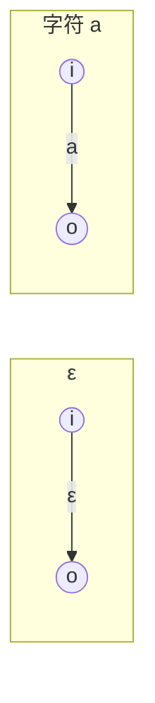
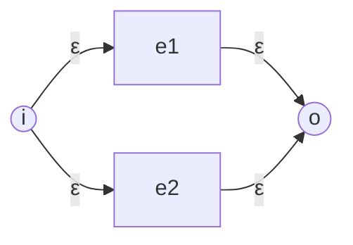
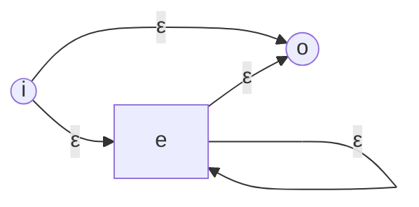
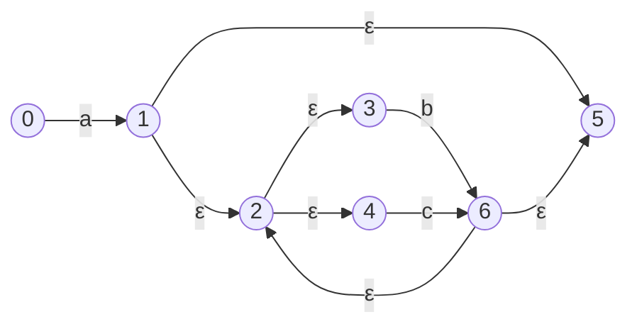

构建自动机（Automata Construction）
================================

本章属于词法分析专题。总览见 [词法分析](../(1)词法分析.md)；正则写法见 [正则表达式](./正则表达式.md)；DFA/NFA 概念见 [自动机理论](./自动机理论.md)。

词法分析里，正则描述「一类 token 长什么样」，自动机负责「在输入上高效认出它」。从正则到可执行的识别器，常见有两条路：

1. **正则 → NFA → DFA**：先用 Thompson 等方法得到 NFA，再用子集构造确定化。
2. **正则 → DFA**：在正则语法树上做位置标注，直接得到 DFA 转移。

多规则场景下，往往还要先（或同时）做 [自动机合并](./自动机合并.md)，再确定化。两条路线在思想上接近，差别主要是中间是否显式保留 NFA。

### 从正则表达式构造非确定有限自动机（NFA）

Thompson 构造把正则的每种运算对应成一小块 NFA「积木」，再按语法树拼起来。约定：每块积木都有唯一入口、唯一出口（出口先不标成接受态，整棵树拼完后再把总出口当作接受态）。

#### 原子

- **空串 $\varepsilon$**：入口 --$\varepsilon$--> 出口。
- **字符 $a$**：入口 --$a$--> 出口。

#### 并 $e_1 \mid e_2$

新建入口 $i$、出口 $o$；$i$ 用 $\varepsilon$ 连到 $e_1$、$e_2$ 的入口；$e_1$、$e_2$ 的出口用 $\varepsilon$ 连到 $o$。

#### 串接 $e_1 e_2$

把 $e_1$ 的出口与 $e_2$ 的入口用 $\varepsilon$ 相连（或直接识别为同一状态）；整体入口为 $e_1$ 入口，出口为 $e_2$ 出口。

#### 闭包 $e^*$

新建入口 $i$、出口 $o$；$i$ --$\varepsilon$--> $e$ 入口；$e$ 出口 --$\varepsilon$--> $o$；同时 $e$ 出口 --$\varepsilon$--> $e$ 入口（可重复），以及 $i$ --$\varepsilon$--> $o$（可零次）。

#### 例子：`a(b|c)*`

按语法树自底向上拼：先字符 `a`；再 `b|c`；再对其做 `*`；最后与 `a` 串接。得到的 NFA 能识别「一个 a，后面跟任意个 b 或 c」。

（状态编号仅示意；实现里由构造算法分配。双圆/接受态为状态 5。）

多条规则时：对每条正则各做一次上述构造，再按 [自动机合并](./自动机合并.md) 接到公共起点。

### 从 NFA 构造确定有限自动机（DFA）

NFA 在同一输入上可能处于**状态集合**。子集构造把「可能处于的集合」当成 DFA 的一个状态。

关键操作：

- **$\varepsilon$-闭包** $\varepsilon(T)$：从集合 $T$ 只走 $\varepsilon$ 边能到达的所有状态（含自身）。
- **转移** $\mathrm{move}(T, a)$：从 $T$ 中各状态经标号 $a$ 的边一步到达的状态集合。
- DFA 上：$\delta(T, a) = \varepsilon(\mathrm{move}(T, a))$。

起点：$\varepsilon(\{s_0\})$。若某集合与原 NFA 某接受态相交，则该 DFA 状态为接受态（多规则时还带上优先级最高的规则号）。

对上一节 `a(b|c)*` 的示意 NFA，起点闭包为 $\{0\}$；读 `a` 后进入含 1 及经 $\varepsilon$ 可达的集合，再读 `b`/`c` 在「循环」集合间转移。核心对应关系是：**DFA 状态 = NFA 状态子集**。完整工作表见下一小节。

#### 进阶：子集构造工作表与最小化

沿用上一节的示意 NFA（接受态为 5）。先算若干 $\varepsilon$-闭包：

| $T$ | $\varepsilon(T)$ |
|-------|----------|
| $\{0\}$ | $\{0\}$ |
| $\{1\}$ | $\{1,2,3,4,5\}$ |
| $\{6\}$ | $\{2,3,4,5,6\}$ |

用大写字母命名出现过的 DFA 状态（含死状态 $\emptyset$）：

| 名 | NFA 子集 | 接受？ |
|----|----------|--------|
| $A$ | $\{0\}$ | 否（起点） |
| $B$ | $\{1,2,3,4,5\}$ | 是（含 5） |
| $C$ | $\{2,3,4,5,6\}$ | 是 |
| $D$ | $\emptyset$ | 否 |

子集构造工作表（每格为 $\varepsilon(\mathrm{move}(\cdot,\cdot))$）：

| 状态 | $a$ | $b$ | $c$ |
|------|-------|-------|-------|
| $A$ | $B$ | $D$ | $D$ |
| $B$ | $D$ | $C$ | $C$ |
| $C$ | $D$ | $C$ | $C$ |
| $D$ | $D$ | $D$ | $D$ |

读 `abb`：$A \xrightarrow{a} B \xrightarrow{b} C \xrightarrow{b} C$，停在接受态，正确。读单独的 `b`：$A \xrightarrow{b} D$，拒绝。

**状态数上界。** 若 NFA 有 $n$ 个状态，DFA 至多 $2^n$ 个子集；最坏可达指数级。典型例子是形如 $(a\mid b)^*a(a\mid b)^{k}$ 的语言：NFA 规模随 $k$ 线性增长，而任何 DFA 都需要约 $2^{k+1}$ 个状态才能「记住」最近 $k$ 个符号是否匹配模式。词法规则里很少刻意写成这种最坏形，但实现仍要按「按需发现可达子集」来做，避免一上来枚举全部 $2^n$ 个集合。

**与最小化的衔接。** 上表里 $B$ 与 $C$ 对 $a,b,c$ 的转移目标完全相同，且同为接受态，故在 [自动机最小化](./自动机最小化.md)（如 Hopcroft）看来二者等价，可并成一个接受态 $S$。并后得到：

| 状态 | $a$ | $b$ | $c$ |
|------|-------|-------|-------|
| $A$ | $S$ | $D$ | $D$ |
| $S$ | $D$ | $S$ | $S$ |
| $D$ | $D$ | $D$ | $D$ |

这正是语言「一个 `a`，后面任意个 `b`/`c`」的最小 DFA：先吃掉 `a`，再在接受态上自环。子集构造保证正确，最小化负责把表压小。

### 从正则表达式直接构造确定有限自动机（DFA）

也可以不做显式 NFA，而在**标注过的正则语法树**上算位置集合，直接得到 DFA。

直觉步骤：

1. 把正则写成语法树，叶子为字符（及结束标记 `#`）；给每个字符叶子编**位置**编号。
2. 自底向上计算节点是否**可空**（nullable），以及 **Firstpos** / **Lastpos**。
3. 由 Lastpos 与 Firstpos 的关系计算每个位置的 **Followpos**。
4. 以 Firstpos(根) 为 DFA 起点；对每个未处理的位置集合 $S$ 与每个字符 $a$，令转移目标为 $S$ 中标号为 $a$ 的那些位置的 Followpos 之并。

主例仍用 `a(b|c)*`，构造时写成带结束标记的 `a(b|c)*#`。完整标注与转移表见下一小节。

多规则时：可先 [合并](./自动机合并.md) 各 NFA 再子集构造；也可在一棵带「规则接受标记」的树（或森林并到一个假根）上做同一套位置计算。直接构造同样大量依赖「把多块语言拼进一台机」的思想，故建议先熟悉合并节的冲突与标记约定。

#### 进阶：`a(b|c)*#` 的位置标注与 DFA 表

把表达式看成语法树 $(a\cdot(b\mid c)^*)\cdot\#$，字符叶子编号：

| 位置 | 符号 |
|------|------|
| 1 | `a` |
| 2 | `b` |
| 3 | `c` |
| 4 | `#` |

节点记法：$n_a,n_b,n_c,n_{\#}$ 为叶子；$n_{\mid}=b\mid c$；$n_*=(b\mid c)^*$；$n_1=a\cdot n_*$；$n_{\mathrm{root}}=n_1\cdot\#$。

**nullable / Firstpos / Lastpos**（叶子：不可空，对位置 $i$ 有 $Firstpos=Lastpos=\{i\}$；`|` 取并；$\cdot$ 按左/右是否可空合并；`*` 可空且 First/Last 同孩子）：

| 节点 | nullable | Firstpos | Lastpos |
|------|----------|----------|---------|
| $n_a$ | 否 | $\{1\}$ | $\{1\}$ |
| $n_b$ | 否 | $\{2\}$ | $\{2\}$ |
| $n_c$ | 否 | $\{3\}$ | $\{3\}$ |
| $n_{\#}$ | 否 | $\{4\}$ | $\{4\}$ |
| $n_{\mid}$ | 否 | $\{2,3\}$ | $\{2,3\}$ |
| $n_*$ | 是 | $\{2,3\}$ | $\{2,3\}$ |
| $n_1$ | 否 | $\{1\}$ | $\{1,2,3\}$ |
| $n_{\mathrm{root}}$ | 否 | $\{1\}$ | $\{4\}$ |

**Followpos** 规则：对每个连接 $c_1\cdot c_2$，每个 $i\in\mathrm{Lastpos}(c_1)$ 都并上 $\mathrm{Firstpos}(c_2)$；对每个闭包 $c^*$，每个 $i\in\mathrm{Lastpos}(c)$ 都并上 $\mathrm{Firstpos}(c)$。

对本树依次得到：

- $n_1$：$\mathrm{Followpos}(1)\supseteq\{2,3\}$
- $n_{\mathrm{root}}$：$\mathrm{Followpos}(1),\mathrm{Followpos}(2),\mathrm{Followpos}(3)$ 各并上 $\{4\}$
- $n_*$：$\mathrm{Followpos}(2),\mathrm{Followpos}(3)$ 各并上 $\{2,3\}$

汇总：

| 位置 | Followpos |
|------|-----------|
| 1 | $\{2,3,4\}$ |
| 2 | $\{2,3,4\}$ |
| 3 | $\{2,3,4\}$ |
| 4 | $\emptyset$ |

**由 Followpos 建 DFA。** 起点 $A_0=\mathrm{Firstpos}(n_{\mathrm{root}})=\{1\}$。对集合 $S$、字符 $x$，目标为「$S$ 中符号为 $x$ 的那些位置」的 Followpos 之并；含位置 4 的集合为接受态。

| 状态 | 位置集 | 接受？ | `a` | `b` | `c` |
|------|--------|--------|-----|-----|-----|
| $A_0$ | $\{1\}$ | 否 | $\{2,3,4\}$ | $\emptyset$ | $\emptyset$ |
| $A_1$ | $\{2,3,4\}$ | 是 | $\emptyset$ | $\{2,3,4\}$ | $\{2,3,4\}$ |
| $A_\emptyset$ | $\emptyset$ | 否 | $\emptyset$ | $\emptyset$ | $\emptyset$ |

与上一节最小化后的结果同构：$A_0$ 对应起点，$A_1$ 对应接受自环态。两条路线识别同一语言；直接构造跳过显式 NFA，状态从一开始就是位置集合。

### 小结

| 路线 | 中间结果 | 优点 |
|------|----------|----------|
| 正则 → NFA → DFA | 显式 NFA，便于合并多规则 | 调试清晰 |
| 正则 → DFA | 位置集合即状态 | 实现更紧凑，少一层 NFA 存储 |

得到 DFA 之后，通常还会做状态最小化以缩小表项，见 [自动机最小化](./自动机最小化.md)。整条流水线回到 [词法分析](../(1)词法分析.md) 的「自动生成词法分析器」一节对照阅读更顺。
