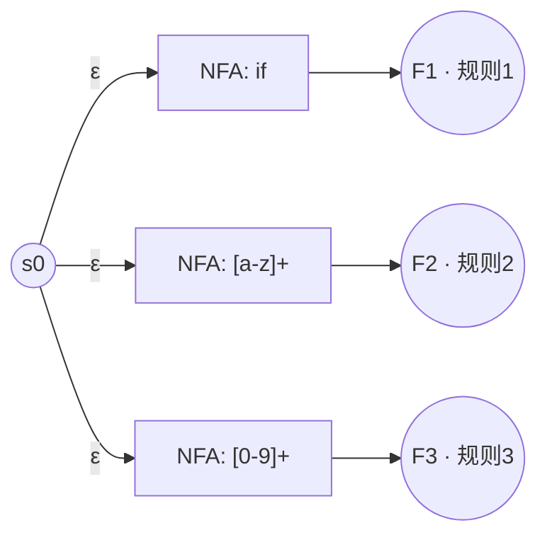

自动机合并
==========

本章属于词法分析专题。总览见 [词法分析](../(1)词法分析.md)。

词法分析器通常要同时识别很多类 token：关键字、标识符、数字、运算符……每一类都可以先写成一条正则，再各自变成一台小自动机。真正跑起来时，输入流只有一条，分析器却必须在「当前前缀可能属于哪几条规则」之间同时推进。把多台自动机合成一台来跑，就是这一节说的**自动机合并**。

若还不熟悉 NFA / DFA 的基本概念，建议先读 [自动机理论](./自动机理论.md)。单条正则如何变成 NFA / DFA，见 [构建自动机](./构建自动机.md)；规则本身如何用正则写，见 [正则表达式](./正则表达式.md)。

### 为什么要合并

假设有三条规则（声明顺序即优先级，序号越小越高）：

1. 关键字：`if`
2. 标识符：`[a-z]+`
3. 数字：`[0-9]+`

若三台机各跑各的，就要对同一段输入维护三套状态，还要在结束时比较谁匹配得更长、谁优先级更高。更常见的做法是：先把各规则的 NFA **并成一台**，共用一个起点；每个原规则的终结态带上规则编号。之后只需在这一台上做确定化（或直接构造 DFA），运行时维护一套状态即可。

### 合并方法：新起点 + $\varepsilon$ 边

对每条规则 $R_i$，先得到一台 NFA $N_i$（构造细节见构建章），其起点为 $s_i$，终结态集合为 $F_i$。

合并步骤：

1. 新建公共起点 $s_0$。
2. 从 $s_0$ 向每个 $s_i$ 连一条 **$\varepsilon$ 边**（不消耗输入）。
3. 保留各 $N_i$ 内部转移；每个 $f \in F_i$ 标记为「可接受，且对应规则 $i$」。

示意（规则画成黑盒）：

合并后的机器仍是 NFA：从 $s_0$ 出发，$\varepsilon$ 闭包会同时进入各规则的起点，之后随输入字符在多条规则上「并行」前进。

### 冲突策略

合并解决的是「同时推进」；真正吐出哪个 token，还要靠匹配策略（与 [词法分析](../(1)词法分析.md)、[正则表达式](./正则表达式.md) 中的说法一致）：

1. **最长匹配**：在输入上尽量吃更长的前缀；例如 `iff` 应整段识为标识符，而不是先吐 `if` 再剩 `f`。
2. **同长比优先级**：若多个终结态同时可达且匹配长度相同，取**声明顺序更靠前**的规则。例如输入恰好是 `if` 时，规则 1 与规则 2 都可能接受，应输出关键字而不是标识符。

实现上，DFA 的每个状态可记录「当前集合里优先级最高的可接受规则」；扫描时在无法再转移（或按实现选择提交点）时，用该规则生成 token。

### 小例子：`if` 与标识符

只看规则 1、2。读入 `if` 结束时，合并机可同时处于「关键字接受」与「标识符接受」；长度相同，选规则 1。读入 `iff` 时，关键字机无法吃完，标识符机可接受更长串，选规则 2。

### 和构建自动机的关系

- 单条规则：正则 → NFA（或直接 → DFA），见 [构建自动机](./构建自动机.md)。
- 多条规则：先按本节合并各 NFA，再对合并结果做子集构造得到 DFA；也可以在直接构造 DFA 的框架里，把多规则写成带规则标记的语法树后再走同一套位置标注。

无论哪条路线，**冲突策略都作用在「接受态所带的规则信息」上**，合并只是把多规则放进同一台机器里。合并并确定化之后，通常还会做 [自动机最小化](./自动机最小化.md)。
