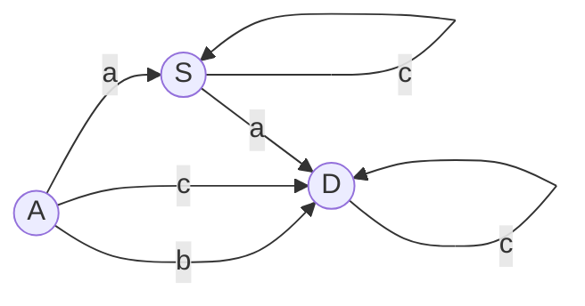

自动机最小化
================

本章属于词法分析专题。总览见 [词法分析](../(1)词法分析.md)。

自动机在构建后，人们一直希望它跑得更快，那么如何优化呢？

词法分析器里的 DFA，通常落成一张**状态转移表**：行是当前状态，列是输入字符（或字符类），格子里是下一状态。运行时几乎每个字符都要查一次表。状态一多，表就大：一方面占内存，另一方面表项更难挤进 CPU 缓存——缓存未命中时，同样的「读一个字符、查一次转移」会明显变慢。所以状态数不只是理论指标，也直接影响热路径上的常数因子。

一种最核心的思路是：**在保持识别语言不变的前提下减少状态**，从而缩小表、提高缓存命中率。这就是本章的核心：如何构造与原 DFA **等价的最小自动机**。

前置：[构建自动机](./构建自动机.md) 得到 DFA；[自动机理论](./自动机理论.md) 交代 DFA / NFA 基本概念；多规则场景见 [自动机合并](./自动机合并.md)。

## 等价状态

若从状态 $p$、$q$ 出发，对**任意**输入串 $w$，要么都接受，要么都拒绝，则称 $p$ 与 $q$ **等价**（不可区分），记作 $p\equiv q$。等价的状态在识别功能上完全相同，最小化时可以合并成一个。

更便于检查的说法是：若存在某个字符 $a$，使得 $\delta(p,a)$ 与 $\delta(q,a)$ 落在**不同的等价类**里，则 $p$ 与 $q$ 可区分，因而**不等价**。接受态与非接受态一上来就可区分（空串 $\varepsilon$ 就能分开它们）。

### 例子：接续 `a(b|c)*`

[构建自动机](./构建自动机.md) 对 `a(b|c)*` 子集构造后得到（含死状态 $D=\emptyset$）：

| 状态 | $a$ | $b$ | $c$ | 接受？ |
|------|-----|-----|-----|--------|
| $A$ | $B$ | $D$ | $D$ | 否 |
| $B$ | $D$ | $C$ | $C$ | 是 |
| $C$ | $D$ | $C$ | $C$ | 是 |
| $D$ | $D$ | $D$ | $D$ | 否 |

观察 $B$ 与 $C$：二者都是接受态，且对 $a,b,c$ 的后继完全一样（$a\to D$，$b\to C$，$c\to C$）。因此 $B\equiv C$，可并成一个接受态 $S$。

这就是该语言的最小 DFA：先吃掉一个 `a` 进入接受态，再在 $S$ 上用 `b`/`c` 自环。

## 划分精化

手工找「谁和谁一样」容易漏。系统做法是**划分精化（partition refinement）**：

1. 初始划分：按「能否接受」分成两块——$F$（接受）与 $Q\setminus F$（非接受）。不可达状态可先丢掉。
2. 反复检查：若同一块里的两个状态，在某个字符 $a$ 下走到了**不同块**，就把当前块按后继所在块拆开。
3. 直到再也拆不动。此时每一块内的状态彼此等价；每块收缩成最小 DFA 的一个状态，转移按代表元抄过来即可。

对上表走一遍：

**初始：** $P_0=\{\,\{A,D\},\{B,C\}\,\}$（非接受 / 接受）。

先看非接受块 $\{A,D\}$：

| 状态 | $a$ 落到的块 | $b$ 落到的块 | $c$ 落到的块 |
|------|--------------|--------------|--------------|
| $A$ | $\{B,C\}$ | $\{A,D\}$ | $\{A,D\}$ |
| $D$ | $\{A,D\}$ | $\{A,D\}$ | $\{A,D\}$ |

$a$ 上后继分属不同块，故拆开：$\{A\}$ 与 $\{D\}$。此时 $P_1=\{\,\{A\},\{D\},\{B,C\}\,\}$。

再看接受块 $\{B,C\}$：

| 状态 | $a$ 落到的块 | $b$ 落到的块 | $c$ 落到的块 |
|------|--------------|--------------|--------------|
| $B$ | $\{D\}$ | $\{B,C\}$ | $\{B,C\}$ |
| $C$ | $\{D\}$ | $\{B,C\}$ | $\{B,C\}$ |

后继类型一致，**不拆**。

**稳定划分：** $P=\{\,\{A\},\{D\},\{B,C\}\,\}$。合并 $\{B,C\}$ 为 $S$，即得上一节的三态最小机。字母表更大或状态更多时，往往要对新块多轮扫描直到稳定。

## Hopcroft 算法

上面的「整表扫描直到不动」是正确的，但朴素实现最坏可达 $O(n^2|\Sigma|)$ 量级。**Hopcroft 算法**用更聪明的方式选择「用哪一块、哪个字符去拆分其他块」，把复杂度降到 $O(n\log n\cdot|\Sigma|)$ 量级（$n$ 为状态数），是词法/正则工具里常用的最小化实现。

直觉上它仍做划分精化，只是：

- 维护一个待处理的「分割器」队列（某块 + 某字符）；
- 只处理可能真正引起分裂的组合，避免反复空扫。

对 `a(b|c)*` 这种小例子，Hopcroft 与朴素精化得到**同一**最小机；差别在大表上的常数与渐近。实现时优先用现成库或教材上的 Hopcroft 伪代码即可，本章只需抓住：**最小化 = 合并不可区分状态 = 划分的稳定细份**。

## 小结

| 步骤 | 作用 |
|------|------|
| 正则 → DFA（[构建](./构建自动机.md)） | 得到正确识别器，状态可能偏多 |
| 多规则 [合并](./自动机合并.md) | 一台机识别多类 token |
| **最小化** | 等价压缩，缩小转移表、利于缓存 |
| 生成代码 | 按最小 DFA 出表或硬编码转移 |

注意：最小化保持的是**语言等价**；若 DFA 状态上还挂着「规则优先级 / token 种类」等动作标签，合并前要保证标签一致（或把「带不同动作的接受态」视为一开始就可区分），否则会并错语义。整条词法自动生成流水线见 [词法分析](../(1)词法分析.md)。
