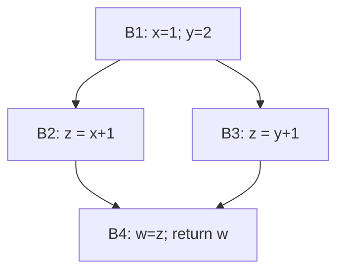

数据流分析（DataFlow Analysis）
===============================

数据流分析不是某一种具体算法，而是一类**在控制流图（CFG）上传播程序事实**的分析框架。同一套套路可以回答不同问题：变量在某点是否还可能被使用、某次赋值能否到达某点、某个表达式是否已经算过、指针可能指向哪些对象，等等。其结果支撑常量传播、死代码消除、寄存器分配、别名与指针相关优化，以及若干静态检查。


## 数据流分析的基本思想

把程序看成 CFG：节点是基本块（或更细的程序点），边是可能的控制转移。数据流分析要做的事可以概括成三步：

1. **选定要传播的信息**——例如「当前可用的表达式集合」「当前活跃的变量集合」「可能到达的定义集合」。
2. **给每个基本块定一条转移函数（transfer）**——根据块内语句，由入口信息算出出口信息（或反过来）。常见操作是：本块**产生（gen）**一些事实，并**杀死（kill）**被本块推翻的事实。
3. **在汇合处合并（meet）**——`if/else` 汇合、循环入口等有多条入边（或出边）的地方，要把各路带来的信息合成一份。合并方式取决于问题：要「任意路径上可能成立」时常用**并集**；要「所有路径上都成立」时常用**交集**。

若图中有环（循环），信息可能沿环反复增强或削弱，因此需要**迭代**：反复应用转移与合并，直到每个点上的信息不再生效变化——即到达**不动点**。不动点保证：在当前抽象下，传播已经稳定，可以拿结果做优化或检查。

按传播方向还可分成：

- **前向**：信息从入口沿执行方向往后传（如到达定义、可用表达式）。
- **后向**：信息从出口沿反方向往前传（如活跃变量）。

活跃变量、到达定义、可用表达式，用的都是这套框架，差别只在「传什么、怎么 gen/kill、用并还是交、前向还是后向」。


## 数据流分析的应用

### 可用表达式分析（Available Expression Analysis）

可用表达式分析要回答：**到达某个程序点时，哪些表达式已经在所有到达该点的路径上都被计算过，且运算对象此后未被修改？**

它是典型的**前向 + 交集**分析：某表达式要在汇合点仍「可用」，必须在每一条入边上可用；块内若重新定义了表达式用到的变量，就会杀死相关可用表达式。分析结果可用于公共子表达式消除：若 `a + b` 在某点可用，就不必再算一遍，可复用先前的结果。


### 活跃变量分析（Live Variable Analysis）

活跃变量分析要回答：**在某个程序点，变量 `x` 的当前值是否还可能在将来被使用？**

更准确地说：从该点出发，是否存在一条路径，在这条路径上**先使用了 `x`，且在这次使用之前没有对 `x` 的重新定义**。若存在，则称 `x` 在该点**活跃（live）**；否则称其**死亡（dead）**。这与「变量是否在作用域内」不是一回事——作用域由语言规则决定，活跃性由**之后还会不会读这个值**决定。

#### 块上的 use / def

对每个基本块 $B$，先扫一遍语句，得到两个集合（顺序很重要）：

- $\mathrm{use}[B]$：在 $B$ 内**被使用，且在该次使用之前本块尚未重新定义**的变量。  
  例如块内是 `t = x; x = 1`，则 $x \in \mathrm{use}[B]$（先读到旧值）；若是 `x = 1; t = x`，则 $x \notin \mathrm{use}[B]$（读的是本块刚写的值）。
- $\mathrm{def}[B]$：在 $B$ 内被赋值（定义）过的变量。

#### 数据流方程

活跃性必须从「将来」往回推，因此是**后向 + 并集**：

```
OUT[B] = ∪ IN[S]          （S 是 B 的所有后继）
IN[B]  = use[B] ∪ (OUT[B] − def[B])
```

含义：出口处活跃的变量 = 各后继入口活跃集合的并；入口处活跃 = 本块自己要用的，再加上「出口仍活跃、且本块没有盖掉」的变量。过程出口（没有后继）的 $\mathrm{IN}$ 视为空，故最后一块的 $\mathrm{OUT}$ 初始为 $\emptyset$。

有环时从保守初值（常取各 $\mathrm{IN}/\mathrm{OUT}$ 为空集）反复迭代，直到不再变化。

#### 例子

下面这段程序与下一节「到达定义」共用，便于对照前向 / 后向：

```c
// B1
x = 1;
y = 2;
if (cond) goto B2; else goto B3;

// B2
z = x + 1;
goto B4;

// B3
z = y + 1;
goto B4;

// B4
w = z;
return w;
```



各块的局部集合（假定 `cond` 不涉及 `x,y,z,w`）：

| 块 | $\mathrm{use}$ | $\mathrm{def}$ |
|----|----------------|----------------|
| B1 | $\emptyset$ | $\{x,y\}$ |
| B2 | $\{x\}$ | $\{z\}$ |
| B3 | $\{y\}$ | $\{z\}$ |
| B4 | $\{z\}$ | $\{w\}$ |

说明：B4 中 `w = z` 先使用 `z`；随后 `return w` 使用的是本块刚定义的 `w`，因此 $w \notin \mathrm{use}[\mathrm{B4}]$。

从出口往回算（无环，一轮即可）：

1. $\mathrm{OUT}[\mathrm{B4}] = \emptyset$  
   $\mathrm{IN}[\mathrm{B4}] = \{z\} \cup (\emptyset - \{w\}) = \{z\}$
2. $\mathrm{OUT}[\mathrm{B2}] = \mathrm{IN}[\mathrm{B4}] = \{z\}$  
   $\mathrm{IN}[\mathrm{B2}] = \{x\} \cup (\{z\} - \{z\}) = \{x\}$
3. 同理 $\mathrm{IN}[\mathrm{B3}] = \{y\}$
4. $\mathrm{OUT}[\mathrm{B1}] = \mathrm{IN}[\mathrm{B2}] \cup \mathrm{IN}[\mathrm{B3}] = \{x,y\}$  
   $\mathrm{IN}[\mathrm{B1}] = \emptyset \cup (\{x,y\} - \{x,y\}) = \emptyset$

| 块 | $\mathrm{IN}$（入口活跃） | $\mathrm{OUT}$（出口活跃） |
|----|---------------------------|----------------------------|
| B1 | $\emptyset$ | $\{x,y\}$ |
| B2 | $\{x\}$ | $\{z\}$ |
| B3 | $\{y\}$ | $\{z\}$ |
| B4 | $\{z\}$ | $\emptyset$ |

读法：进入 B2 时只有 `x` 还要在将来被用；`y` 在走 B2 的路径上已经死亡。B4 入口需要 `z`，出口不再需要任何变量。

#### 用途

- **寄存器分配**：同一时刻活跃的变量不能占用同一寄存器（构造干涉图）。  
- **删除死赋值**：若赋值目标在赋值后的程序点不活跃，且该语句无副作用，通常可删。  
- 与后文「死代码消除」中的**无用计算**一类直接相关。


### 到达定义分析（Reaching Definition Analysis）

到达定义分析要回答：**程序执行到某一点时，某个变量当前的值可能来自哪几条赋值语句？**

这里的「定义」指一次赋值。给每条赋值一个编号（如 $d_1:\, x = 1$）。若从该赋值出发存在一条路径到达某个程序点，且途中该变量没有被重新赋值覆盖，就称这个定义**到达（reach）**了该点。

与活跃变量对照：活跃变量问「这个值**还要不要**」；到达定义问「这个值**可能从哪次写入来**」。

#### 块上的 gen / kill

对每个基本块 $B$：

- $\mathrm{gen}[B]$：本块内产生的定义。若同一变量在块内被多次赋值，通常只保留**最后一次**对该变量的定义（前面的已被块内后面的覆盖）。  
- $\mathrm{kill}[B]$：程序中其它地方对「本块所定义变量」的那些旧定义——它们一旦经过本块就被盖掉。

#### 数据流方程

信息沿执行方向往后传，汇合取「可能」，因此是**前向 + 并集**：

```
OUT[B] = gen[B] ∪ (IN[B] − kill[B])
IN[B]  = ∪ OUT[P]          （P 是 B 的所有前驱）
```

入口块的 $\mathrm{IN}$ 通常取空集（或加上形式参数等「边界定义」）。有环时同样迭代到不动点。

#### 例子

仍用上一小节的四块程序，定义编号如下：

| 编号 | 语句 | 所在块 |
|------|------|--------|
| $d_1$ | `x = 1` | B1 |
| $d_2$ | `y = 2` | B1 |
| $d_3$ | `z = x + 1` | B2 |
| $d_4$ | `z = y + 1` | B3 |
| $d_5$ | `w = z` | B4 |

| 块 | $\mathrm{gen}$ | $\mathrm{kill}$ |
|----|----------------|-----------------|
| B1 | $\{d_1,d_2\}$ | $\emptyset$（没有其它 `x`/`y` 定义） |
| B2 | $\{d_3\}$ | $\{d_4\}$（盖掉另一条对 `z` 的定义） |
| B3 | $\{d_4\}$ | $\{d_3\}$ |
| B4 | $\{d_5\}$ | $\emptyset$ |

从入口往前算：

1. $\mathrm{IN}[\mathrm{B1}] = \emptyset$  
   $\mathrm{OUT}[\mathrm{B1}] = \{d_1,d_2\}$
2. $\mathrm{IN}[\mathrm{B2}] = \{d_1,d_2\}$  
   $\mathrm{OUT}[\mathrm{B2}] = \{d_3\} \cup (\{d_1,d_2\} - \{d_4\}) = \{d_1,d_2,d_3\}$
3. 同理 $\mathrm{OUT}[\mathrm{B3}] = \{d_1,d_2,d_4\}$
4. $\mathrm{IN}[\mathrm{B4}] = \mathrm{OUT}[\mathrm{B2}] \cup \mathrm{OUT}[\mathrm{B3}] = \{d_1,d_2,d_3,d_4\}$  
   $\mathrm{OUT}[\mathrm{B4}] = \{d_5\} \cup \{d_1,d_2,d_3,d_4\}$

| 块 | $\mathrm{IN}$（入口可达定义） | $\mathrm{OUT}$ |
|----|------------------------------|----------------|
| B1 | $\emptyset$ | $\{d_1,d_2\}$ |
| B2 | $\{d_1,d_2\}$ | $\{d_1,d_2,d_3\}$ |
| B3 | $\{d_1,d_2\}$ | $\{d_1,d_2,d_4\}$ |
| B4 | $\{d_1,d_2,d_3,d_4\}$ | $\{d_1,d_2,d_3,d_4,d_5\}$ |

读法：进入 B4 时，`z` 的值可能来自 $d_3$ 或 $d_4$（两条分支各写一次）；`x` 仍只能来自 $d_1$。因此 `w = z` 用到的 `z` **不是**单一到达定义——不能直接当常量折叠，除非再配合别的信息。

#### 用途

- **常量 / 拷贝传播**：某次使用若只被唯一一个常量（或拷贝）定义到达，就可替换。  
- **建立 def-use 关系**：看每个定义能到达哪些使用。  
- **发现死定义**：若某个定义到达不了任何使用，该赋值多半无用（还需考虑副作用）。


### 指向分析（Points-to Analysis）

指向分析要回答：**在某个程序点，指针可能指向哪些抽象对象？**

与前面「集合里有没有某个标志」不同，这里传播的是**指向关系**（例如 `p → {a, b}`）：

- `p = &a`：记下 `p` 可能指向 `a`
- `p = q`：把 `q` 的可能指向集合赋给 `p`
- `*p = ...` 或 `x = *p`：需要沿着 `p` 的可能指向去更新或读取目标对象

由于分支与循环，结果通常是集合（保守的「可能指向」），而不是唯一答案。精度取决于是否上下文敏感、流敏感等，越细越准也越贵。算法细节见 [指向分析](./(7)指向分析.md)；它是别名分析、若干内存相关检查与优化的基础。


### 死代码消除（Dead Code Elimination）

死代码消除（DCE）要删掉**对程序可观察行为没有贡献**的代码。它通常不是又一套独立的数据流方程，而是前面分析结果（活跃变量、到达定义、常量折叠后的 CFG 等）的**应用**：先判断「没用」，再改写 IR。

实现上必须**保守**：拿不准时宁可少删。多删一条有副作用的语句，就会改程序语义。

#### 两类「死」

1. **不可达代码（unreachable）**  
   控制流永远到不了。例如 `if (0) { ... }` 的 then 分支，或常量折叠后变成永假的条件所守护的整块。判断依据主要是 CFG 可达性，不一定先跑活跃分析。

2. **无用计算（useless / dead computation）**  
   语句能执行到，但算出的值之后没有人读，且该语句本身没有必需的副作用。典型依据是[活跃变量分析](#活跃变量分析live-variable-analysis)：赋值之后目标变量不活跃，这条赋值往往可删。

两类可以同时出现：先删不可达块，再在剩余图上做活跃性驱动的无用赋值删除。

#### 基于活跃性的删除

对赋值 `x = e`（或等价的定义），若在**该赋值之后**的程序点 `x` 不活跃，且该语句无副作用，则可删除。删除后不必保留 `e` 的计算（除非 `e` 本身有副作用——那时应保留副作用部分，或整句都不敢删）。

沿用本章菱形例子的变体：若 B2 写成 `z = x + 1; t = x * 2;`，而后面从未使用 `t`，则在 B2 出口 `t` 不活跃，`t = x * 2` 就是无用计算，可删；`z = x + 1` 仍因 B4 使用 `z` 而必须保留。

```c
// B2'
z = x + 1;   // z 在后继仍活跃 → 保留
t = x * 2;   // t 之后无人使用 → 可删（无副作用时）
goto B4;
```

#### 副作用：什么时候不能删

「结果没人用」不等于「整句可删」。下列情况通常必须保留（或只能做更精细的分析）：

- 可能的 **I/O**、系统调用、同步
- 访问 **`volatile`** 或可能与其它线程共享的内存
- 可能 **抛异常 / 中止** 的调用（删掉会改变是否抛错）
- 写入**逃逸**出去的对象、全局状态，而别名分析无法证明「没人能观察到」

因此 DCE 常与别名 / 指向信息配合：对 `*p = ...` 这类存储，若不能证明无观察者，就不能当纯局部死赋值删掉。

#### 级联删除（迭代）

删掉一条无用赋值后，它的操作数上的**定义**可能变成新的死代码。例如：

```c
a = b + 1;
c = a * 2;   // 若 c 死，删掉后 a 也可能变死
```

实务上会：

- **多轮**：删一批 → 再跑活跃分析 → 再删，直到不动；或  
- **工作表 / 反向依赖**：从刚变死的变量追到其唯一定义，检查是否也可删。

只跑一轮往往删不干净。

#### 与常量折叠、控制流简化配合

常量折叠把 `if (x > 0)` 在 `x` 已知为负时变成 `if (false)` 后：

1. then 分支变为**不可达**，整块可删；  
2. 若变成无条件跳转，CFG 边减少，后续活跃集合也可能变小，从而暴露更多无用计算。

所以管道里常见顺序是：稀疏条件传播 / 常量折叠 → 删不可达 → 活跃性 DCE（可迭代），而不是只做其中一步。

#### 标记–清扫式 DCE

另一种常见组织方式（在 [SSA](./(3)SSA.md) 上尤其自然）：

1. **标记根（root）**：必须保留的语句——函数返回值、对参数/全局/逃逸内存的存储、带副作用的调用、以及你规定的「有用」出口。  
2. **沿 def-use 反向标记**：凡是根所依赖的运算与 φ 节点一并标记。  
3. **清扫**：未标记的指令删除。

这与「先算全程序活跃集合再扫赋值」对偶：一个从**有用性**正向/反向长出保留集，一个从**活跃性**判断每个定义是否还有人要。SSA 下每个值只有一处定义，标记依赖更干净；非 SSA 则常直接用块级活跃变量方程。

#### 和到达定义的关系

[到达定义分析](#到达定义分析reaching-definition-analysis)也能提供线索：若某个定义**到达不了任何使用**，它就是无用赋值的候选——但仍要核对副作用，且「到达不到 use」与「赋值后变量不活跃」在良好实现下应一致指向同类垃圾。活跃变量更直接回答「此刻还要不要这个值」；到达定义更直接服务常量传播与 def-use 建边。


