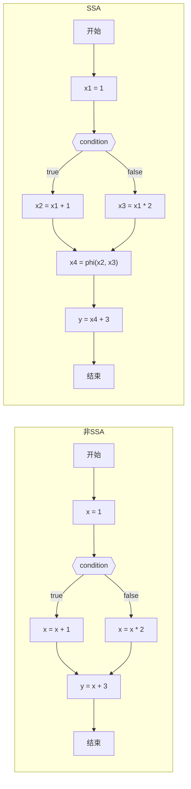
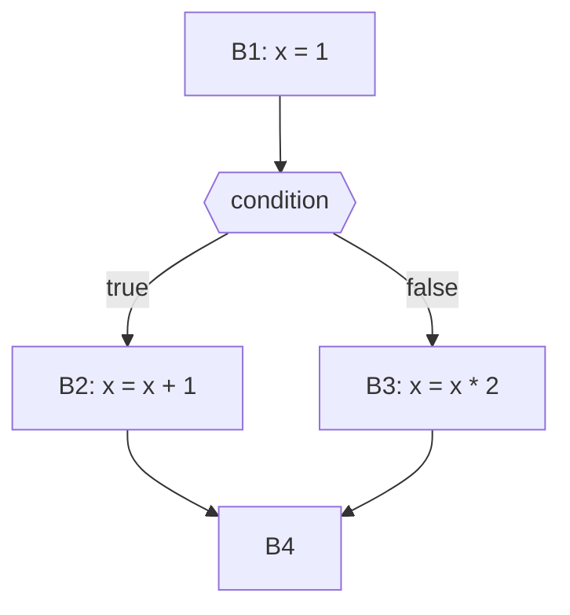
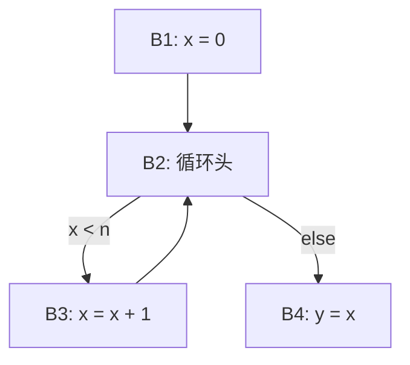

# 静态单赋值（SSA）

静态单赋值（Static Single Assignment，SSA）是一种中间表示形式，其中每个变量只能被赋值一次。这种表示形式在编译器优化中非常有用，因为它简化了数据流分析和转换。在这篇文章中，我们将介绍SSA的基本概念，以及如何将常规的控制流图（Control Flow Graph，CFG）转换为SSA形式。

核心特征：
1. 每个变量只能被赋值一次
2. 使用phi函数来处理不同控制流的赋值

## SSA形式与非SSA形式的对比

为了更好地理解SSA形式，让我们通过一个简单的例子来对比SSA形式和非SSA形式的代码。

### 非SSA形式的代码

考虑以下简单的代码片段：

```c
int x = 1;
if (condition) {
    x = x + 1;
} else {
    x = x * 2;
}
y = x + 3;
```

这段代码中，变量`x`被多次赋值，这就是非SSA形式的特点。我们可以绘制这段代码的控制流图：

### SSA形式的代码

现在，让我们看看等价的SSA形式：

```c
int x1 = 1;
if (condition) {
    int x2 = x1 + 1;
} else {
    int x3 = x1 * 2;
}
int x4 = φ(x2, x3);  // phi函数，根据控制流选择x2或x3
int y = x4 + 3;
```

在SSA形式中，每个变量只被赋值一次，我们使用不同的变量名（x1, x2, x3, x4）来表示不同控制流路径上的值。φ函数（phi函数）用于合并不同控制流路径上的值。



## 使用SSA的好处

SSA形式的中间表示有许多优点，这使得它在现代编译器中被广泛采用：

1. **简化数据流分析**：由于每个变量只被赋值一次，变量的定义和使用关系变得更加清晰，这大大简化了数据流分析的复杂性。
2. **消除假依赖**：在传统的中间表示中，变量可能被多次赋值，这会导致一些假依赖关系。而在SSA形式中，每个变量只有一个定义点，消除了这些假依赖。
3. **优化机会增加**：SSA形式使得许多优化算法（如常量传播、值编号、死代码消除等）变得更加有效和容易实现。
4. **更好的寄存器分配**：SSA形式可以帮助编译器更准确地确定变量的生命周期，从而进行更有效的寄存器分配。
5. **并行性分析**：SSA形式使得识别程序中的并行执行机会变得更加容易，因为数据依赖关系更加明确。
6. **更容易实现全局优化**：由于SSA形式提供了更清晰的变量定义和使用信息，全局优化算法可以更容易地识别和利用优化机会。
7. **简化编译器后端**：SSA形式可以简化编译器后端的实现，因为许多优化和分析算法在SSA形式上更容易实现。
8. **更好的调试信息**：SSA形式可以提供更准确的变量定义和使用信息，这对于生成调试信息和进行程序分析非常有用。

总的来说，SSA形式通过简化变量的定义和使用关系，为编译器优化提供了更多的机会和更简单的实现方式。

## 如何将常规的控制流图（CFG）转换为SSA形式

### 计算支配树和支配边界

在一个控制流图中，支配关系（Dominance Relation）是非常重要的概念，它描述了要想到达一个结点，你必须经过哪些结点，这样就可以帮助我们快速决定一个结点中的变量，会被哪些结点中的变量修改所影响。
用数学语言描述就是：对于有向图 G，有起点 S 和终点 D，从 S -> D 存在许多条路径，在所有路径中都经过的点称为支配节点。在 S -> D 中可能存在很多支配点。这里，如果对应一个函数的话，S 就是函数的入口，D 就是函数的所有返回语句所在结点指向的一个共同结点。

支配树（Dominator Tree）是控制流图（CFG）每个结点的直接支配结点组成的树。这个树结果可以帮助我们快速了解每个结点被哪些结点支配。
<ClientOnly><CFG /></ClientOnly>

而支配边界（Dominance Frontier）是控制流图（CFG）每个结点的支配边界。支配边界是支配结点中，不支配该结点的结点。简单理解就是，一个支配结点其实隐含了一个作用范围，在范围里，所有变量都会受到支配结点的影响。而支配边界就是，这个范围的边界。

### 插入φ函数

#### 为什么需要 φ

普通 CFG 里，变量在汇合点之后的「当前值」可能来自多条前驱边。例如文首代码里，$B_4$ 的 `y = x + 3` 读到的 `x`，既可能是 then 里写的，也可能是 else 里写的。非 SSA 表示把这种「多定义到达同一使用」藏在同一个名字里；到达定义分析要用集合来描述它。

SSA 的做法不同：在汇合块**入口**显式插入一条 φ 赋值，把各前驱带来的值合成一个**新的**定义。之后该块内（以及被该定义支配的后续）只使用这个新名字。约定：

- φ 写在基本块最前面，语义上属于「进入该块时」执行。
- φ 有 $k$ 个操作数当且仅当该块有 $k$ 个前驱；第 $i$ 个操作数对应第 $i$ 条入边——控制流从哪条边进来，就取哪一侧的值。
- φ **不是**可在目标机上直接执行的指令，而是 IR 里的合流记号；后端出 SSA 时会拆成按前驱边的拷贝或寄存器移动。

#### 插在哪里：支配边界

上一节把支配边界理解成一次赋值「影响范围」的出口。更精确地说：若基本块 $B$ 里对变量 $v$ 有一次赋值，那么凡是「有一条从 $B$ 出发的路径到达、且 $B$ 不再支配」的那些结点，都是该赋值可能与其它路径上的赋值「碰头」的地方——也就是可能需要 φ 的地方。Cytron 等人证明：对 $v$ 的**最小** φ 集合，恰好可以通过反复取「定义块的支配边界」得到（**最小 SSA**）。此处不展开 pruned / semi-pruned 变体（它们会删掉一些「后面根本没用到」的 φ）。

关键直觉：

- 只在「真有多条定义可能到达」的汇合点插 φ，避免在每个有多前驱的块上都盲目插入。
- 插进去的 φ **本身也是一次定义**，它的支配边界上可能还要再插 φ（典型出现在循环、嵌套汇合），所以算法必须**迭代**。

#### 算法（按变量、工作表）

对**每个**变量 $v$ 单独做一遍（不同变量的 φ 互不干扰）：

1. 收集初始定义块集合 $\mathrm{Defs}(v)$：所有含有对 $v$ 赋值的基本块。函数入口对参数、未显式初始化的局部等，常视为入口块上的**隐式定义**，也要放进 $\mathrm{Defs}$。
2. 把 $\mathrm{Defs}(v)$ 拷入工作表 $W$。
3. 当 $W$ 非空时，弹出一个块 $B$，对每个 $Y \in \mathrm{DF}(B)$：
   - 若 $Y$ 中**还没有**关于 $v$ 的 φ，则在 $Y$ 入口插入  
     `v = φ(v, v, …, v)`（操作数个数 = $Y$ 的前驱数；此时操作数仍是占位符，真正的版本号留给下一步「变量重命名」填写）；
   - 把 $Y$ 加入 $\mathrm{Defs}(v)$，并若尚未处理过则加入 $W$（因为 φ 是新定义，可能在更远的 DF 上再触发插入）。
4. $W$ 空则该变量处理完毕。

伪代码骨架：

```
for each variable v:
    W = Defs(v)          // 含隐式定义
    Seen = Defs(v)
    while W not empty:
        B = W.pop()
        for Y in DF(B):
            if Y has no φ for v:
                insert φ for v at entry of Y
                if Y not in Seen:
                    Seen.add(Y)
                    W.push(Y)
```

复杂度大致与「变量数 × 定义次数相关的 DF 规模」成正比；实际编译器会对每个块预计算 $\mathrm{DF}$，再按变量扫定义。

#### 例子一：文首的 if/else（一轮即可）

记：

| 块 | 语句 |
|----|------|
| $B_1$ | `x = 1`；按 condition 跳到 $B_2$ 或 $B_3$ |
| $B_2$ | `x = x + 1`；跳到 $B_4$ |
| $B_3$ | `x = x * 2`；跳到 $B_4$ |
| $B_4$ | `y = x + 3` |



支配关系（简述）：$B_1$ 支配所有块；$B_2$、$B_3$ 互不支配对方，也不支配 $B_4$；$B_4$ 被 $B_1$ 支配。于是：

- $\mathrm{DF}(B_2) = \{B_4\}$，$\mathrm{DF}(B_3) = \{B_4\}$
- $\mathrm{DF}(B_1)$ 通常不含 $B_4$（从 $B_1$ 到 $B_4$ 的路径都仍被 $B_1$ 支配），$\mathrm{DF}(B_4)$ 视出口边而定，本例可视为空或不影响 `x`

对 `x`：初始 $\mathrm{Defs} = \{B_1, B_2, B_3\}$。处理 $B_2$、$B_3$ 时都会在 $B_4$ 插入**同一个**关于 `x` 的 φ（第二次发现已有则跳过）。处理 $B_1$ 不会在 $B_4$ 再插第二个。结果：

```
B4:
    x = φ(x, x)    // 两前驱：来自 B2 / B3 的占位
    y = x + 3
```

重命名后即前文的 `x4 = φ(x2, x3)`。注意：$B_1$ 里的初值定义通过 then/else 里的赋值「传到」φ 的操作数一侧时，会在重命名阶段体现为 then/else **右值**用的 `x1`，而不是在 $B_4$ 再为 $B_1$ 单独插一条 φ。

#### 例子二：循环——为何必须迭代

考虑：

```c
x = 0;
while (x < n) {
    x = x + 1;
}
y = x;
```

简化 CFG：$B_1$（`x = 0`）→ $B_2$（循环头：判断；循环体回来也进入这里）→ 退出到 $B_4$（`y = x`）；循环体 $B_3$（`x = x + 1`）→ 回到 $B_2$。



$B_3$ 对 `x` 的赋值会「漏出」到循环头 $B_2$（$B_2$ 在 $\mathrm{DF}(B_3)$ 中），因此要在 $B_2$ 入口插 φ。该 φ 又是新定义，其影响沿循环边与退出边传播，常使退出路径也正确读到循环头版本。**若不做「φ 也加入 Defs」的迭代，循环回边上的合流就会漏插。** 重命名后循环头形如：

```
B2:
    x2 = φ(x1, x3)   // 初入循环来自 B1 的 x1；回边来自 B3 的 x3
    if (x2 < n) ...
B3:
    x3 = x2 + 1
B4:
    y = x2           // 或再经退出处 φ，取决于具体分块
```

#### 插入阶段结束时的状态

此时每个需要合流的点都有了 φ，但：

- 左值、右值仍都叫 `x`，尚未分成 `x1, x2, …`；
- φ 的操作数还是占位，还没绑定到「沿哪条入边到达的哪个定义」。

这两件事都由下一步完成。顺序必须是：**先插完所有 φ，再做变量重命名**——重命名要依赖「块首已有 φ」以及支配树上的作用域结构。

### 变量重命名

#### 要解决什么问题

插入 φ 只解决了「在何处合流」，没有解决「每次定义和使用分别是哪一个版本」。SSA 要求：

1. 程序中每一次**赋值**（含 φ）产生一个独一无二的名字（如 `x1`, `x2`, …）；
2. 每一次**使用**精确指向某一个定义——在支配关系下，就是「当前点所能看到的、最新的那个版本」。

若只做全文搜替换式的编号，很难处理：嵌套分支里内层定义不应污染外层；离开内层块后应恢复外层版本；φ 的各个操作数必须分别来自**对应前驱块出口**处的版本，而不是汇合块自己入口的版本。

经典做法：对每个变量维护一个**栈**（栈顶 = 当前支配域内最新版本）和一个**计数器**；按**支配树**做深度优先遍历——因为「$A$ 支配 $B$」恰表示：进入 $B$ 前一定经过 $A$，且 $A$ 里的定义在 $B$ 内仍然可见（除非被 $B$ 的祖先到 $B$ 路径上的更新定义覆盖，而这些更新会按 DFS 顺序压栈）。

#### 算法步骤

初始化：对每个变量 $v$，栈为空，`counter[v] = 0`。可选：在入口块处理隐式定义时先 `new_name(v)` 压栈。

辅助操作 `new_name(v)`：`counter[v]++`，生成名字 $v_i$，压入 $v$ 的栈，返回 $v_i$。

过程 `rename(B)`（$B$ 为当前基本块）：

1. **统计本块将压栈的次数**（离开时要弹回去），记为 $c$。
2. **先处理块首 φ 的左值**（不要读 φ 的操作数——操作数由前驱填写）：对每个 `v = φ(...)`，令左值为 `new_name(v)`，并计入压栈。
3. **按语句顺序处理普通指令**：
   - 右值中每个变量 $v$ 替换为栈顶名字（当前版本）；
   - 若有对 $v$ 的赋值，左值改为 `new_name(v)`。
4. **填写 CFG 后继里的 φ 操作数**：对 $B$ 的每个后继 $S$，若 $S$ 入口有关于 $v$ 的 φ，设 $B$ 是 $S$ 的第 $j$ 个前驱，则把 φ 的第 $j$ 个操作数写成**当前**栈顶的 $v$ 版本（即 $B$ 出口处可见的版本）。
5. **递归**：对支配树上 $B$ 的每个子结点 $C$，调用 `rename(C)`。
6. **回溯**：将本块新压入的 $c$ 个名字全部弹出，恢复进入 $B$ 之前的栈，以便兄弟子树看到正确的外层版本。

从支配树根（通常是入口块）调用 `rename(entry)` 即可。

要点强调：

- φ 的**目标**在进入汇合块时命名；φ 的**参数**在处理各个前驱时填写——所以同一条 φ 会在不同前驱的 `rename` 中被写不同槽位。
- 必须沿支配树而不是只沿 CFG 遍历：CFG 上的后继可能跑到未被当前块支配的结点，那些结点的「栈状态」不属于当前支配域，不能在那里改名；后继只用于**填 φ 槽**，真正进块改名要等支配树 DFS 轮到该块。
- 栈的弹出保证：then 里产生的 `x2` 不会漏到 else；else 仍看到分支前的 `x1`。

#### 例子：文首 if/else 逐步演算

支配树（与 CFG 不同）：$B_1$ 为根，子结点为 $B_2$、$B_3$、$B_4$（具体孩子顺序不影响最终 SSA，只影响遍历次序；下面按 $B_2 \to B_3 \to B_4$）。

插 φ 之后、重命名之前，$B_4$ 已有 `x = φ(x, x)`。

| 步骤 | 动作 | `x` 的栈（底→顶） | 生成 / 填写的代码 |
|------|------|-------------------|-------------------|
| 进入 $B_1$ | `x = 1` → 新名 | `[x1]` | `x1 = 1` |
| 填后继 φ | $B_1$ 不直接进 $B_4$ | `[x1]` | （无） |
| 进入 $B_2$ | 右值用栈顶；左值新名 | `[x1, x2]` | `x2 = x1 + 1` |
| 填 $B_4$ 的 φ | $B_2$ 为 $B_4$ 第 1 前驱 | `[x1, x2]` | `φ` 第 1 槽 ← `x2` |
| 离开 $B_2$ | 弹出本块压入的 `x2` | `[x1]` | |
| 进入 $B_3$ | 同理 | `[x1, x3]` | `x3 = x1 * 2` |
| 填 $B_4$ 的 φ | $B_3$ 为第 2 前驱 | `[x1, x3]` | `φ` 第 2 槽 ← `x3` |
| 离开 $B_3$ | 弹出 `x3` | `[x1]` | |
| 进入 $B_4$ | 先给 φ **左值**新名 | `[x1, x4]` | `x4 = φ(x2, x3)` |
| 普通语句 | `y = x + 3` 的 `x` 用栈顶 | `[x1, x4]` | `y = x4 + 3` |
| 离开 $B_4$ | 弹出 `x4` | `[x1]` | |

最终与前文「SSA 形式的代码」一致：

```c
int x1 = 1;
if (condition) {
    int x2 = x1 + 1;
} else {
    int x3 = x1 * 2;
}
int x4 = φ(x2, x3);
int y = x4 + 3;
```

读法：`x2`/`x3` 只在各自分支内定义；汇合后统一经 `x4` 使用；then/else 右值都正确读到分支前的 `x1`，正是「离开分支时弹栈」的结果。

#### 与循环例子的对应

在上一小节的 `while` 中，重命名后循环头 `x2 = φ(x1, x3)` 的两个操作数来源是：

- 处理 $B_1$ 结束、即将进入循环时，栈顶为 `x1`，沿 $B_1 \to B_2$ 填入 φ 的「初入」槽；
- 处理 $B_3$ 时栈顶为 `x3`，沿回边 $B_3 \to B_2$ 填入「迭代」槽；
- $B_3$ 内 `x = x + 1` 的右值则是循环头 φ 的目标 `x2`（进入 $B_3$ 时栈顶已是 `x2`）。

这把「第一次迭代用初值、之后用上轮更新」的语义，变成了 IR 上两条明确的数据边，后续常量传播、归纳变量识别等都可以直接沿着这些边做。

#### 小结

| 阶段 | 输入 | 输出 |
|------|------|------|
| 插 φ | CFG + 支配边界 + 各变量定义块 | 块首带占位操作数的 φ |
| 重命名 | 带 φ 的 CFG + 支配树 | 每个定义唯一版本；使用与 φ 槽均指向正确版本 |

两步做完，CFG 即处于 SSA 形式：静态地看，每个名字只有一次赋值；动态地看，φ 在运行时按进入边选择操作数。之后的中端优化（常量传播、值编号、死代码消除等）都可以建立在清晰的 def–use 链上。
