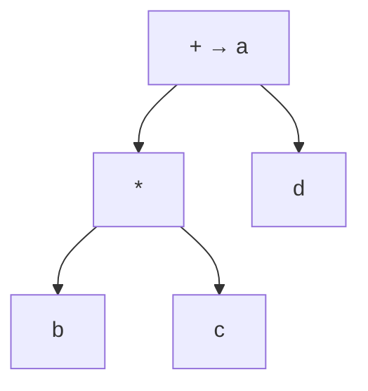
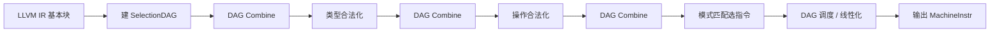
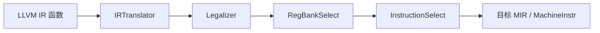

指令选择（Instruction Selection）
=================


后端要把目标无关的中间表示（IR）落到具体 ISA 上的机器指令。这一步就是**指令选择**：在保持语义的前提下，为每段计算挑选（组合）合适的目标指令。它通常紧接在中端优化之后，并与后续的 [指令调度](./(2)指令调度.md)、[寄存器分配](./(3)寄存器分配.md) 分工——选择决定「用哪些指令形态」，调度决定「何时发射」，分配决定「放进哪些寄存器」。

IR 从哪来，见 [中间代码生成](../1.前端/(4)中间代码生成.md)。


## 为什么不是一对一翻译

若每条三地址码都机械地扩成固定模板，实现简单，但往往更慢、更长。原因包括：

1. **同一计算多种覆盖**：例如 $t=b\cdot c+d$ 可做成 `mul` 再 `add`，也可在支持乘加的机器上做成一条 `madd`。
2. **寻址模式**：`load` 常能把「基址 + 偏移」「基址 + 变址」折进一条访存指令，等价于少做几次算术。
3. **立即数 / 条件码 / 标志位**：比较与分支、带移位的算术等，都会改变「树的哪一块」该被一条指令吃掉。
4. **架构特性**：不同的架构有不同的指令集，ARM和X86的设计区别很大，因此需要根据架构特性来选择合适的指令。

因此指令选择本质是：**用目标机提供的指令模式（pattern / tile）去覆盖 IR 的运算图，并在多种合法覆盖中挑代价较小的一种**。


## 树模式匹配

把一个基本块里的表达式看成树（或 DAG：公共子表达式共享节点）。每条目标指令对应一个**模式**：根是该指令计算结果，子树形状对应操作数约束（寄存器、立即数、内存操作数等）。

### 最大吞噬（Maximal Munch）

自顶向下、每次在当前根上匹配**能盖住最深（或最大）**的合法模式，递归处理未覆盖的子树。实现快，常能吃到复杂寻址与融合指令，但不保证全局代价最优——贪心可能挡住更好的组合。

### 按代价的最优覆盖

给每个模式标代价（周期、代码尺寸或加权和）。对树上每个节点 $n$，求：

$$
\mathrm{cost}(n)=\min_{\text{模式 }p\text{ 匹配于 }n}\left(\mathrm{cost}(p)+\sum_{c\in\mathrm{children}_p(n)}\mathrm{cost}(c)\right)
$$

自底向上动态规划即可；匹配成功的模式记录下来，最后自顶向下吐出指令。这是经典「指令选择 = 树覆盖」教材算法；DAG 上要处理共享节点被多次计价的问题，实践中常先树化或改用图匹配启发式。


## 例子：$a = b \times c + d$

三地址码：

```
t1 = b * c
a  = t1 + d
```

对应表达式树：根为 `+`，左孩子为 `*`（$b,c$），右孩子为 $d$。

假设目标机有这些模式（代价仅为示意）：

| 模式 | 含义 | 代价 |
|------|------|------|
| `mul r,r → r` | 寄存器相乘 | 3 |
| `add r,r → r` | 寄存器相加 | 1 |
| `madd r,r,r → r` | $r_d \leftarrow r_a\cdot r_b + r_c$ | 3 |
| `mov r → r` | 传送（必要时） | 1 |

**覆盖 1（逐条）**：`*` 用 `mul`（3），`+` 用 `add`（1），总代价 $4$。

**覆盖 2（融合）**：整棵 `madd` 盖住根（3），总代价 $3$。

最大吞噬若从根看到 `madd` 可匹配，会直接选覆盖 2。若机器没有 `madd`，则只剩覆盖 1。动态规划在节点 `+` 上比较「只用 add + 左子树最优」与「madd 模式」，会选出代价为 3 的融合方案。



虚线可理解为第二种覆盖：一条 `madd` 同时盖住 `+` 与 `*`。


## 实现视角

### 宏扩展 / 模板

最简单：为每种 IR 操作写固定汇编模板。适合教学编译器与极少指令集；难处理跨多条 IR 的寻址与融合。

### 树 / DAG 匹配器

用描述文件写出「IR 子树 → 机器指令」规则（如历史悠久的 Twig、BURG，或 LLVM 的 `SelectionDAG` + `td` 模式），编译时生成匹配器，运行时对每个基本块的 DAG 做覆盖。合法化（legalize）往往先把目标不支持的类型/操作降级成支持的形态，再选指令。

### LLVM 中的指令选择

LLVM 后端要把中端产出的 **LLVM IR**（SSA、基本块、类型较丰富）变成 **Machine IR（MIR）** 上的 `MachineInstr`，再去做调度微调、寄存器分配、开槽（prolog/epilog）等。指令选择是这条链上「第一次真正变成目标指令形态」的关键一步。历史上有三条相关路径，今天教学与文档里最常对比的是前两条优化路径，外加一条快路径：

| 路径 | 粒度 | 中间形态 | 典型用途 |
|------|------|----------|----------|
| SelectionDAG ISel | 基本块 | 专用 DAG | 长期默认的优化选型 |
| GlobalISel | 函数（可跨块） | gMIR → MIR | 新一代框架，逐步接替 |
| FastISel | 基本块 | 快速模板/规则 | `-O0` 编译速度优先；失败可回退 |

下面按管线把 SelectionDAG 与 GlobalISel 说清楚，并对应回前文的「模式覆盖 / 合法化」概念。

#### SelectionDAG ISel（经典 DAG 选型）

对每个基本块大致经历：



1. **建 DAG（SelectionDAGBuilder）**  
   把该块的 LLVM IR 译成一棵（实际是）**SelectionDAG**：节点是目标相关的 SDNode（如 `add`、`load`、`CopyFromReg`），边表示数据依赖；同一值被多处使用则共享节点，所以是 DAG 而非纯树。块的入口/出口通过「复制到虚拟寄存器 / 从虚拟寄存器复制」等节点与 CFG 衔接。这与教材里「表达式 DAG 上做覆盖」是同一类对象。

2. **DAG Combine**  
   在合法化前后多次运行的窥孔式化简：常量折叠、无关节点删除、把多节点收成目标更喜欢的形态（为后面的 pattern 做准备）。可理解为选型前的「把图收拾干净」。

3. **合法化（Legalize）**  
   目标机并非支持任意位宽与任意操作。SelectionDAG 传统上分两阶段（中间夹 Combine）：  
   - **类型合法化**：把 `i128`、奇怪向量宽等拆成目标合法的类型（扩展、截断、拆成多寄存器等）。  
   - **操作合法化**：把目标不支持的 opcode 降级为支持的序列（例如用库调用、用多条指令模拟）。  
   合法化之后，图上只应留下「该目标宣称可处理」的类型与操作，否则后面的 pattern 无法匹配。

4. **指令选择（Select）**  
   用 **TableGen（`.td`）** 写的模式把 DAG 子图匹配成目标指令节点。模式描述「什么样的 SDNode 树 → 哪条 `MachineInstr` / 哪个目标 SDNode」，并可带谓词与代价。匹配器由 `td` 生成；策略上接近 **最大吞噬 + 代价启发**，而不是对整棵树做教科书式全局最优 DP。匹配成功后，图上逐渐变成「目标指令节点」；选不中则报错或走 fallback。

5. **调度与发射**  
   SelectionDAG 上的节点还需排成线性指令序列（考虑依赖与简单资源），然后 **Emit** 成该函数的 `MachineInstr` 列表（仍大量使用**虚拟寄存器**）。之后才进入机器级的调度优化、[寄存器分配](./(3)寄存器分配.md) 等。

**`.td` 在这里扮演什么角色？**  
目标描述里既有寄存器类、指令编码，也有 `Pat<...>` / `PatFrag` 一类模式。例如「`add` 的两子节点是 `mul` 与某寄存器」可写成匹配 `madd` 的规则——正是前文 $b\cdot c+d$ 融合在工程上的落点。合法化保证进入匹配的图「形状合法」；`.td` 保证「合法形状」能落到具体 opcode。

**局限（也是 GlobalISel 要解决的动机）：**

- 每个基本块重建、销毁一套重型 DAG，**编译时间**开销大。  
- **看不到块间**信息，跨块的选型/合法化机会受限。  
- SelectionDAG 与最终 MIR **两套表示**，调试与测试都偏「黑盒」；与 FastISel 代码路径分叉，复用差。

#### GlobalISel（通用机器 IR 上的选型）

GlobalISel 的目标是：尽量**直接在 MIR 家族上工作**，用可组合的 Pass 完成「翻译 → 合法化 → 选寄存器组 → 选目标指令」，以便复用、可测、并逐步替代 SelectionDAG / FastISel。

核心管线（可在合法化前后插入 Combiner）：



1. **IRTranslator**  
   把 LLVM IR **翻译成 gMIR（Generic MIR）**：仍是 MIR 的数据结构（基本块、指令、虚拟寄存器），但操作是通用的 `G_ADD`、`G_LOAD`、`G_ICMP` 等，虚拟寄存器先带 **LLT**（Low Level Type，如标量位宽）等较松的约束，还不绑死具体寄存器类。类比：SelectionDAGBuilder 建 DAG；这里建的是「还没选完目标」的机器级指令流，且以**函数**为范围，而不是一次只啃一个块。

2. **Legalizer**  
   迭代地把不合法的 **类型与操作**改成目标支持的形态（扩展、拆分、lowering、必要时 custom）。与 SelectionDAG 不同，这里**不强制**「先全部类型合法化、再全部操作合法化」两阶段，而是按规则集循环改写，直到稳定。规则由目标的 `LegalizerInfo`（常通过 `getActionDefinitionsBuilder`）描述：哪些 `(opcode, 类型)` 直接 legal，哪些要 widen/narrow/lower/clamp 等。合法化结束后，不应再留下目标声明不支持的 gMIR 操作。

3. **RegBankSelect（寄存器组选择）**  
   现代目标常有多组寄存器（通用、浮点、向量）。此步给虚拟寄存器选定 **Register Bank**，约束后续能选哪些指令变体（例如同一加法在 GPR 与 FPR 上可能是不同 opcode）。这是 SelectionDAG 路径里相对分散、在 GlobalISel 里被单独成 Pass 的一层「选型前约束」。

4. **InstructionSelect**  
   把剩下的通用 `G_*` 指令替换成**真正的目标指令**。匹配同样大量依赖 TableGen / 选择器表；选完后函数中不应再残留 gMIR 通用操作，表示已进入普通 MIR，交给后续 CodeGen。

**和 SelectionDAG 的概念对齐：**

| 教材 / SelectionDAG | GlobalISel |
|---------------------|------------|
| 建 DAG | IRTranslator → gMIR |
| Legalize types/ops | Legalizer（统一迭代） |
| （隐含的寄存器约束） | RegBankSelect |
| Select + 部分调度发射 | InstructionSelect |
| 块级 | 函数级（跨块机会更多） |

**工程现状（理解用）：**  
GlobalISel 已在部分目标、部分优化级别上作为默认或可选路径；遇无法处理的情况仍可能 **fallback 到 SelectionDAG**。写后端时两套都可能碰到：读 `.td` 模式、看 `LegalizerInfo`、或调试 `-debug-only` 下的 ISel 日志。

#### 选型之后还剩什么

无论 SelectionDAG 还是 GlobalISel，选出的指令里操作数多半仍是**虚拟寄存器**。物理寄存器短缺、调用约定、spill 等由 [寄存器分配](./(3)寄存器分配.md) 处理；为填满流水线而重排相邻指令则接近 [指令调度](./(2)指令调度.md)。把「合法化 + 模式覆盖」想清楚，再去读 LLVM 某目标的 `*ISelDAGToDAG*` / `*InstructionSelector*` / `*LegalizerInfo*`，会容易很多。


## 小结

| 问题 | 要点 |
|------|------|
| 输入 / 输出 | 优化后 IR → 目标指令（常仍含虚拟寄存器） |
| 核心模型 | 用指令模式覆盖表达式树/DAG，并比较代价 |
| 贪心 | Maximal munch，快，不保证最优 |
| 最优树覆盖 | 按代价 DP；DAG/共享需额外处理 |
| 工程 | 模板；LLVM SelectionDAG（建 DAG / 合法化 / `.td` 匹配）与 GlobalISel（gMIR 管线） |

指令选择解决「用什么指令」；之后还要解决「何时执行」和「放在哪颗寄存器里」，三者一起决定最终代码质量。
