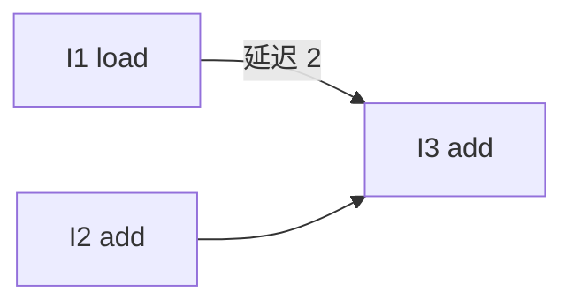

指令调度（Instruction Scheduling）
=================

[指令选择](./(1)指令选择.md) 决定「用哪些机器指令」；**指令调度**决定在依赖与机器资源允许的前提下，「这些指令按什么顺序发射」。目标通常是减少流水线空泡、提高吞吐，有时也兼顾功耗或代码尺寸。选出的指令里往往仍是虚拟寄存器，物理寄存器要交给 [寄存器分配](./(3)寄存器分配.md)。


## 为什么要调度

现代 CPU 是流水线（甚至超标量）：一条指令从取指到写回要多拍，乘加、访存延迟往往更长。若下一条指令立刻用到上一条的结果，就要**停顿等待**。若中间能插入**互不依赖**的其它指令，流水线就能继续干活。

调度不能乱改语义：必须尊重数据相关与必要的控制相关，也不能让同一时刻争用的功能部件过载（发射宽度、ALU/AGU/FP 端口等）。因此调度 = 在约束下的**指令重排**。


## 主要约束

### 数据相关

对寄存器（或内存，分析更保守）上的读写：

| 名称 | 含义 | 例子 |
|------|------|------|
| RAW（真相关） | 先写后读 | `r1 = ...` 后 `... = r1` |
| WAR（反相关） | 先读后写 | 读完 `r1` 才能改写 `r1` |
| WAW（输出相关） | 两次写同一位置 | 两次写 `r1` 的次序要保持结果正确 |

真相关决定「结果多久之后才能用」（延迟）；反相关/输出相关在换名（SSA、寄存器分配换名）后有时可减弱，调度器仍常保守处理。

### 控制相关与资源

分支后面的指令能否上移，取决于是否推测执行、是否在同一基本块内调度。资源方面：每拍能发射几条、哪些功能部件互斥，都会限制「就绪指令」里真正能选出的集合。


## 表调度直觉

基本块内调度常用**依赖图 + 列表调度**：

1. 节点 = 指令；边 = 必须先后（并带延迟）。
2. 维护**就绪队列**：前驱都已排完、且满足延迟的指令。
3. 每一拍从就绪队列按启发（关键路径最长、延迟最大、寄存器压力等）选若干条发射，更新后续节点的最早可发射时间。

### 小例子

假设 `load` 结果要 2 拍后才能用，`add` 延迟 1：

```
r1 = load [r0]     // I1，延迟 2
r2 = r3 + r4       // I2，与 load 无关
r5 = r1 + r2       // I3，依赖 I1、I2
```

原序：`I1 → I2 → I3`。若 `I2` 紧跟 `I1`，等 `r1` 时可能空 1 拍。把 `I2` 挪到 `I1` 之后立刻执行，用独立加法填等待，再执行 `I3`，总时间往往更短。



就绪顺序可以是：先发 `I1` 与 `I2`（若双发射）或 `I1` 再 `I2`，最后等延迟满足后发 `I3`。


## 调度与寄存器分配的拉锯

把无关指令插进长延迟空隙，会**拉长**某些值的活跃区间，寄存器更紧张，可能多 spill；为减少寄存器压力而挤在一起排，又可能**排不满**流水线。编译器常在「表前调度 / 表后调度」间权衡，或在分配后再做一次局部调整。序言里后端三步——选择、调度、分配——在实现上往往**交错、迭代**，而不是严格流水线只走一遍。


## 表调度与表后调度

| | 时机 | 特点 |
|--|------|------|
| 表调度（pre-RA） | 寄存器分配前 | 虚拟寄存器多，自由度大，易拉高寄存器压力 |
| 表后调度（post-RA） | 分配后 | 物理寄存器与 spill 已定，重排空间小，适合填剩余空泡、照顾流水线细节 |

SelectionDAG 线性化时也有一轮「像调度」的排序；机器级还有 `MachineScheduler` 一轮。


## 小结

| 要点 | 内容 |
|------|------|
| 目标 | 在保持语义下重排，减少等待、提高吞吐 |
| 约束 | 数据相关、控制相关、发射/功能部件资源 |
| 方法直觉 | 依赖图 + 就绪列表 + 启发选指令 |
| 与 RA | 填空泡 ↔ 活跃区间变长，需要折中 |
| 前后 | 输入来自指令选择；输出仍可能含虚拟寄存器，再交给寄存器分配 |


