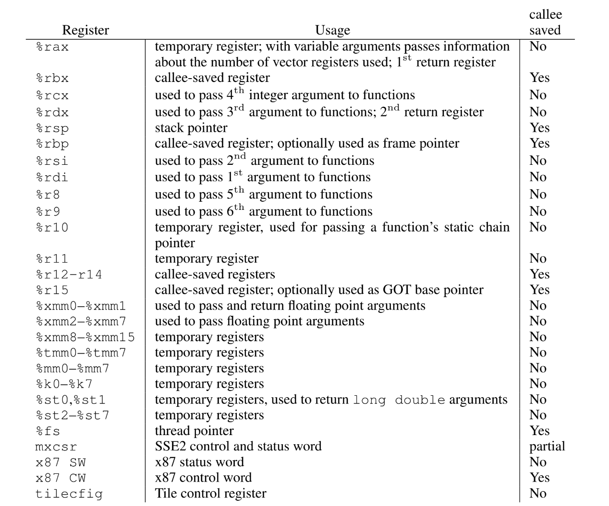

栈帧（Stack Frame）
=================

函数调用不仅要转移到被调用函数的代码，还需要保留返回位置，以及调用者之后仍要使用的状态。编译器通常按照调用约定生成指令，在当前线程的栈上安排这些数据。一次调用所使用的这部分栈结构称为**栈帧（stack frame）**。

栈帧的建立与撤销通常通过调整栈指针、保存和恢复寄存器完成，不需要操作系统为每次调用单独分配一块内存。栈空间不足而需要建立新的页面映射时，才可能涉及缺页处理等内核工作。

## 交互演示：main 调用 addThree

下面以 **Linux x86-64 System V ABI** 为例，展示 `main` 调用 `addThree`，再逐层返回的完整过程。点击“下一步”观察每条教学指令执行后的栈和寄存器，也可以自动播放、回退或拖动进度条。

<StackFrameVisualizer />

演示采用保留 `rbp` 帧指针、不使用 red zone 的教学布局。局部变量刻意放在栈上，地址经过简化；实际编译结果可能使用寄存器、内联或省略帧指针，并不一定具有相同的栈结构。

观察时可以关注以下变化：

+ **调用与建立帧基址是不同步骤**：`call` 压入返回地址；`push rbp` 保存旧帧指针；`mov rbp, rsp` 才建立新的帧基址。
+ **两个栈帧同时存在**：`addThree` 执行时，`main` 的局部变量仍在它自己的槽位中。新的 `rbp` 指向被调函数，旧值则保存在栈中。
+ **参数与返回值可以走寄存器**：本例用 `rdi` 传递参数，用 `rax` 返回 `long` 结果；`main` 的 `int` 返回值通过 `eax` 传递。
+ **返回先恢复状态，再转移控制流**：恢复 `rsp` 撤销局部空间，弹出旧 `rbp`，最后由 `ret` 取出返回地址。撤销栈帧不会自动清零其中的字节，但这些局部对象已不能继续使用。

## 栈帧结构

典型栈帧可能包含局部变量、临时值、保存的寄存器、部分参数及返回信息。哪些数据放在栈上、哪些通过寄存器传递，取决于体系结构、ABI 和编译优化。

在本例的帧指针布局中，`rbp` 指向保存旧 `rbp` 的槽位，`[rbp+8]` 是返回地址，局部槽位位于 `rbp` 以下；`rsp` 指向当前栈顶。`rbp - rsp` 可以表示当前预留的局部空间范围，但不包含位于更高地址的返回地址等数据，因此不能笼统当成整个栈帧的大小。

编译器可以省略帧指针，并通过 `rsp` 及已知偏移访问栈数据。省略的是独立的帧基址寄存器用途，不是栈指针本身。普通自动局部对象的生命周期由作用域等语言规则决定，不能因为栈中的字节尚未被覆盖，就在函数返回后继续使用其地址。

## x86 调用约定

这是一个32位平台。 堆栈向下生长。 函数的参数以相反的顺序传递到堆栈上，以便第一个参数是被压入堆栈的最后一个值，然后将成为堆栈上的最小值。 可以通过修改被调函数的参数来修改在堆栈上传递的参数。 使用call指令来调用函数，该指令将下一条指令的地址压入堆栈并跳转到操作数。 函数使用ret指令返回调用者，该指令从堆栈中弹出一个值并跳转到该值。 在调用call指令之前，堆栈是16字节对齐的。

函数保留寄存器ebx，esi，edi，ebp和esp； 而eax，ecx，edx是暂存器。 返回值存储在eax寄存器中，或者如果返回值是64位的，则高32位进入edx，低32位进入eax。 被调函数将ebp推入堆栈，这样紧挨着主调函数栈帧的栈顶，即此时caller-return-eip位于ebp上方4个字节处，然后将ebp设置为已保存ebp的地址。 这允许遍历现有堆栈帧。 GCC 的 `-fomit-frame-pointer` 选项允许编译器省略专用帧指针；实际是否省略还受目标平台和函数情况影响。

作为特殊的例外，GCC假定堆栈未正确对齐，并在输入main或在函数上设置了属性（（force_align_arg_pointer））时将其重新对齐。

## x86-64 调用约定

常见 x86-64 平台的栈向低地址增长，但并非只有一种调用约定：Linux 等平台通常采用 System V AMD64 ABI，Windows 通常采用 Microsoft x64 ABI。以下参数寄存器的说明针对常见整数或指针参数，浮点参数和聚合类型有另外的分类规则。在windows X64中，前4个参数通过rcx，rdx，r8，r9来传递，其余的参数按照从右向左的顺序压栈。在Linux上，则是前6个参数通过rdi，rsi，rdx，rcx，r8，r9传递，其余的参数按照从右向左的顺序压栈。按值传递的参数属于被调函数使用的值；修改该参数不会自动修改调用者的原变量。 使用call指令来调用函数，该指令将下一条指令的地址压入堆栈并跳转到操作数。 被调函数使用ret指令返回调用者，该指令从堆栈中弹出一个值并跳转到该值。 在调用调用指令之前，堆栈是16字节对齐的。

以下寄存器保存规则针对 System V AMD64 ABI。函数保留寄存器rbx，rsp，rbp，r12，r13，r14和r15； rax，rdi，rsi，rdx，rcx，r8，r9，r10，r11是暂存寄存器。 常见整数返回值使用 rax（较窄的 int 使用 eax）；按 ABI 分类可用两个整数寄存器返回的值使用 rax 和 rdx。浮点数、聚合类型及较大对象的返回方式需按具体类型规则处理。 可选地，被调函数推入rbp，以使caller-return-rip在其上方8个字节，并将rbp设置为已保存的rbp的地址。 这允许遍历现有堆栈帧。 GCC 的 `-fomit-frame-pointer` 选项允许编译器省略专用帧指针；实际是否省略还受目标平台和函数情况影响。

信号处理程序在同一堆栈上执行，但是在将任何内容压入堆栈之前，会从堆栈中减去称为红色区域的128个字节。 这允许小的叶子函数使用128字节的堆栈空间，而无需通过从堆栈指针中减去来保留堆栈空间。 众所周知，红色区域会给x86-64内核开发人员造成问题，因为在调用中断处理程序时，CPU本身并不尊重红色区域。 由于ABI与CPU行为相矛盾，这会导致微妙的内核损坏。 解决方案是使用-mno-red-zone或通过在内核模式下在当前堆栈以外的其他堆栈上处理中断来构建所有内核代码（从而实现ABI）。