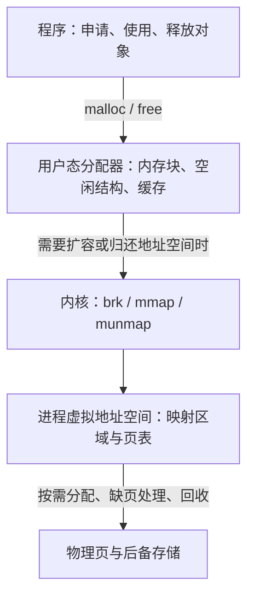

堆（Heap）
===============

函数的栈帧适合保存随调用结束而失效的临时数据，但有些对象需要存活得更久。例如，解析器创建的语法树需要交给后续编译阶段使用，不能随着解析函数返回而消失。这类对象通常通过堆进行动态分配。

堆并不是一块由操作系统直接替程序维护每个对象的“大数组”。从 `malloc(24)` 到实际可读写的内存，中间至少有两层管理：**用户态分配器负责内存块，操作系统负责虚拟地址空间和物理页**。理解这条边界，是理解堆结构、分配算法以及进程隔离的关键。

本文主要以 Linux 与 C 的 `malloc`/`free` 为例。不同分配器的内部布局和策略并不相同，文中的块结构和算法演算是教学模型，不代表某个 glibc 版本的精确实现。关于堆在地址空间中的位置，可先阅读[运行时内存布局](./(1)运行时内存布局.md)。

## 从对象到物理页：谁在管理什么



| 层次 | 管理单位 | 主要职责 |
| --- | --- | --- |
| 程序或语言运行时 | 对象 | 决定申请大小、使用方式和生命周期；执行构造、析构或垃圾回收 |
| 用户态分配器 | 内存块、大小类别、分配区 | 从已有空间寻找可用块，切分与复用空间，维护元数据，协调线程访问 |
| 操作系统 | 虚拟内存区域、页 | 建立映射、检查权限、分配物理页、处理缺页与回收，实施进程隔离 |

一次 `malloc` 可能只从缓存里取出一个空闲块，完全不进入内核。反过来，操作系统即使为进程建立了一个较大的映射，也通常不知道里面包含多少个 C 对象，更不知道哪个对象已经不再使用。

C++ 的 `new` 通常还会在获得存储后构造对象，`delete` 则涉及析构和释放；自定义分配器可能改变其底层路径。具有垃圾回收机制的语言，会由运行时判定哪些对象可以回收，但同样需要与操作系统的页级管理衔接。

## 堆的结构：大区域如何变成小对象

### 分配区、页组与内存块

分配器往往先取得较大的虚拟内存区域，再将其切分成可交给程序使用的小块。常见的组织层次包括：

+ **分配区（arena）**：维护一组内存及其分配状态，用于组织分配和降低线程之间的锁竞争。一个 arena 不一定只对应一个连续映射。
+ **页组（span、run 等）**：部分分配器以一组页作为中间单位，让同一组页服务某个大小类别的对象。
+ **内存块（block、chunk）**：一次分配所占用的管理单位。它可能包含用户数据、管理信息和对齐填充。

这些术语来自不同实现，并不是所有分配器都有相同的三层结构。传统通用分配器常操作可变大小的 chunk，其他实现则大量使用固定大小槽位。更大的对象还可能直接获得独立的映射。

### 块头、有效载荷与对齐

为了在 `free(p)` 时知道该如何处理 `p`，分配器必须有办法找到这次分配的大小、所属区域和状态等信息。一种常见设计是在用户数据前放置块头：

| 块中的部分 | 示例用途 | 程序是否可直接使用 |
| --- | --- | --- |
| 块头（header） | 记录块大小、状态位，或辅助寻找相邻块 | 否 |
| 有效载荷（payload） | `malloc` 返回指针指向的用户数据 | 只能访问所申请的范围 |
| 对齐填充或剩余容量 | 保证块大小和地址满足对齐要求 | 不能因为“看起来还有空间”就越过申请范围 |
| 可选的边界信息 | 辅助反向查找或合并相邻空闲块 | 否 |

这只是一种设计。元数据也可以存放在独立的页级表或其他结构中，并不保证“把指针向前移动固定字节就能找到块头”。程序不应该依赖或修改这些私有信息。

假设教学分配器使用 16 字节块头，所有块按 16 字节对齐，申请 `n` 字节时可以这样计算块大小：

```text
块大小 = align_up(n + 16, 16)
申请 24 字节 → 24 + 16 = 40 → 向上取整到 48 字节
```

这 48 字节包括 16 字节块头、24 字节用户数据以及 8 字节填充。实际实现还可能有最小块大小、不同的元数据布局和独立的大小类别；计算大小时也必须检查整数溢出。

`malloc` 返回的地址应满足基本对齐要求；需要更高对齐的对象应使用 `aligned_alloc` 等合适的接口，而不是假定普通 `malloc` 总能满足任意对齐要求。

### 空闲块如何被找到

只知道哪些块已经分配还不够。分配器还需要高效地找到可用空间，常见方法包括：

+ **隐式空闲表**：沿着整个区域逐块读取大小和状态。结构简单，但寻找空间时会经过已分配块。
+ **显式空闲链表**：只把空闲块串起来。链表指针可以放进空闲块原先的用户数据区，因此需要最小空闲块大小。
+ **分离空闲表（segregated lists / bins）**：按大小范围建立多个链表或其他索引，先到合适的类别中搜索。
+ **树、位图与页级索引**：树可辅助查找可变大小块；位图可表示固定槽位是否空闲，减少逐块扫描。

内存中的相邻关系与链表中的前后关系是两回事。空闲链表可能按大小、地址或释放顺序组织，链表中的两个相邻节点不一定在虚拟地址上相邻。

## 一次分配与释放的过程

### 分配：查找、切分，再按需扩容

一个简化的 `malloc` 流程可以写成：

```text
allocate(n):
    检查大小是否合法，并计算包含元数据与对齐的所需块大小
    在缓存或空闲结构中寻找合适的块
    如果没有合适块：向下层分配区或操作系统申请更多空间
    如果仍然失败：返回失败
    如果剩余部分足够形成合法空闲块：切分并登记剩余块
    标记所选块为已分配
    返回用户数据的起始地址
```

假设某空闲块的**总大小**为 128 字节，使用前面的教学规则申请 24 字节，需要一个 48 字节块。如果最小空闲块大小为 32 字节，剩余的 80 字节就可以形成新空闲块；若剩余部分小于 32 字节，则通常将整个块交给本次分配管理，避免产生无法使用的碎片。

这里的“总大小”包括元数据，不能把总块大小与用户请求大小混用。即使分配器保留了更大的块，程序仍只能依照申请范围访问内存。

### 释放：缓存、登记与合并

`free(p)` 接收的是先前分配返回的指针，不需要调用者再传入大小，因为分配器能通过自身元数据找到相关信息。其常见步骤是：

1. 找到所属块、大小类别和分配区等信息。
2. 将块放入线程缓存或空闲结构，供以后复用。
3. 在策略允许时，与虚拟地址相邻的空闲块合并。
4. 当存在适合归还的大块或空闲页时，考虑把地址空间或物理页交还操作系统。

`free(NULL)` 不执行操作。传入块内部的地址、重复释放或释放不属于该分配接口的指针，都会导致未定义行为。

合并有两种常见策略：**立即合并**在释放时就处理邻居，较快减少碎片，但增加释放成本；**延迟合并**先缓存小块，等待后续分配或整理时再处理，减少频繁切分和合并的开销，但短期可能保留更多碎片。

边界标记（boundary tags）可以帮助找到前后块的大小与状态，实现相邻空闲块合并。实际布局不一定要求每个块都有完整的独立块尾，也不意味着分配器每次释放都会立即合并。

### 用一组操作观察切分与合并

仍使用“16 字节块头、16 字节对齐、最小空闲块 32 字节”的教学模型，假设初始空闲块总大小为 256 字节，并采用立即合并。下表按虚拟地址从低到高列出各块：

| 操作 | 块的排列（数字均为总块大小） | 说明 |
| --- | --- | --- |
| 初始状态 | 空闲 256 | 一个完整空闲块 |
| `a = malloc(24)` | A 48 · 空闲 208 | 24 字节请求需要 48 字节块 |
| `b = malloc(40)` | A 48 · B 64 · 空闲 144 | 40 字节请求需要 64 字节块 |
| `free(a)` | 空闲 48 · B 64 · 空闲 144 | 两个空闲块被 B 隔开，不能直接合并 |
| `free(b)` | 空闲 256 | B 与左右空闲邻居合并 |

在第三次操作后，空闲块总大小为 192 字节，但最大的连续空闲块只有 144 字节。因此，即使空闲总量足够，也未必能满足一个需要 160 字节总块大小的请求。

## 分配算法：如何选择合适的空闲块

### 首次适应、下次适应与最佳适应

这些算法主要描述“在可变大小空闲块中选哪一块”。为了方便比较，假设按遍历顺序有三个空闲块，总大小分别为 96、64、160 字节；当前请求需要一个总大小为 64 字节的块。

| 算法 | 选择规则 | 本例结果 | 主要权衡 |
| --- | --- | --- | --- |
| 首次适应（first fit） | 遇到第一个足够大的块就停止 | 选择 96，剩余 32 | 常能提前结束搜索；结果依赖遍历顺序，前部可能积累碎片 |
| 下次适应（next fit） | 从上次搜索结束的位置继续，必要时绕回 | 若从 160 开始，则选择 160，剩余 96 | 避免每次从头搜索，但不保证碎片更少 |
| 最佳适应（best fit） | 选择能够容纳请求的最小块 | 选择 64，恰好匹配 | 尽量减小本次剩余空间，但可能产生很多小碎片 |
| 最坏适应（worst fit） | 选择最大的可用块 | 选择 160，剩余 96 | 试图留下较大的剩余块，但可能过早消耗大块资源 |

这里假设剩余部分满足最小空闲块要求。若采用线性链表，搜索最坏情况通常需要遍历多个乃至全部空闲块；若使用按大小组织的树或桶，查找成本和实现方式又会不同。“最佳适应”只描述当前选择，并不保证未来分配序列的总体空间利用率最佳。

### 分离空闲表与大小类别

真实程序中，小对象往往很多。分配器可以为不同大小类别维护独立的空闲结构，例如提供能容纳 16、32、48、64 字节用户数据的槽位。申请 24 字节时，直接寻找 32 字节类别中的空闲槽位，而不是扫描整个堆。

这样的设计可以缩短查找路径，并让同类对象集中在相同页组中。代价是向上取整带来的内部碎片，以及各类别缓存空间不一定能马上用于其他类别。类别间距、缓存上限和页组回收策略，都会影响速度与内存占用。

大小类别中的“槽位容量”与前面例子中的“包含块头的总块大小”不是同一口径；实际实现可能把元数据集中存储在页组之外。

### 伙伴算法

伙伴算法（buddy allocation）把一个较大的块递归切分为两个同样大小的块，常使用 2 的幂作为块大小。当请求到来时，找到足够大的块，反复二分，直到达到所需级别。释放时，如果同一级别的**伙伴块**也空闲，就可以合并到上一级。

例如，可用块大小为 256 字节，申请需要至少 60 字节的空间，可以依次切成 128、64 字节，最终分配 64 字节块。具体实现仍需另外考虑元数据和对齐。

伙伴关系由共同的父块决定，不能只因两块大小相同且地址相邻就随意合并。规则明确使查找与合并较容易实现，但申请略大于某个级别时，向上取整可能浪费很多空间，例如 65 字节可能需要 128 字节块。

Linux 在物理页分配中使用伙伴系统等机制；用户态分配器也可以采用类似思想，但不能因此认为普通 `malloc` 总是直接执行内核伙伴算法。两者的管理层次和分配单位不同。

### Slab 与固定大小对象池

对于大量大小相同或相近的对象，可以先取得一组页，把它们切成固定大小的槽位，再用空闲链表或位图管理。申请时取一个槽位，释放时还回槽位，不必每次对任意大小块进行切分和合并。

这类方法适用于编译器中的语法树节点、固定大小消息等，也广泛用于内核对象缓存。Linux 的 slab 类分配器（如 SLUB）在页分配之上管理内核对象；用户态对象池则在进程内部管理自己的对象，两者不能混为一谈。

固定槽位提高了分配效率，但也有约束：某页组中只要还有少数对象存活，就可能无法整体回收；为多个对象类别预留的空间，也可能因使用不均衡而闲置。

实际通用分配器经常组合多种策略：小对象走线程缓存与大小类别，中等对象使用空闲结构，大对象可能单独映射。不存在适合所有工作负载的唯一最佳算法。

## 碎片：为什么还有空闲内存却不能充分利用

**内部碎片**是已经分配给某块、却不能被当前请求有效利用的空间，例如对齐填充和大小类别向上取整产生的剩余容量。块头等元数据也占用空间，但通常单独记为管理开销，比较指标时应先说明统计口径。

**外部碎片**是空闲空间被存活对象隔开，难以形成足够大的连续虚拟地址块。前面“空闲 48 · B 64 · 空闲 144”的状态就是一个例子。

需要注意，`malloc` 对象通常要求用户可见的虚拟地址连续，并不要求背后的物理页连续。物理内存的碎片问题与用户态空闲块碎片不是同一个问题。

合并相邻空闲块可以缓解外部碎片，但无法跨过仍在使用的对象。一般 C/C++ 分配器也不能擅自移动存活对象，因为程序中可能保存着指向它的原始指针。能够追踪并更新引用的运行时，才可能通过压缩式垃圾回收等方式搬移对象、整理空间。

## 操作系统如何管理不同进程的堆

### 每个进程有自己的映射和分配器状态

在通常的 Linux 进程模型中，每个独立进程都有自己的用户虚拟地址空间。内核用内存描述结构管理其映射区域，并通过页表与页面权限控制实际访问。用户态分配器的块头、空闲链表、arena 和线程缓存，则放在该进程自己的地址空间内。

假设进程 A 和进程 B 都有一个数值为 `0x60000000` 的堆地址。这个地址只是各自虚拟地址空间中的位置：

| 进程 | 虚拟地址 | 页表所指向的物理页 | 结果 |
| --- | --- | --- | --- |
| A | `0x60000000` | 物理页 P | A 访问自己的数据 |
| B | `0x60000000` | 物理页 Q | B 访问自己的数据 |

地址数值相同，不代表两个进程在共享对象。处理器根据当前地址空间进行翻译，内核在切换进程执行时切换相应的地址空间上下文；具体硬件还可以借助地址空间标识区分 TLB 缓存。

因此，进程 B 不能仅凭进程 A 的堆指针值就读取 A 的对象。越界写入可能破坏本进程的其他堆对象或分配器元数据，却不会因为另一个进程“碰巧用了相同地址”就写进对方的私有堆。

### `brk` / `sbrk`：调整传统堆的边界

传统堆通常位于程序数据区域之后。**程序中断点（program break）**标记这一区域的结束位置，`brk` 请求设置新的边界，`sbrk` 则提供按增量调整的历史接口。

分配器可以把边界向高地址移动，以获得更多可用的虚拟地址范围；当顶部有足够大的连续空闲区域时，也可能向回收缩。内核会检查地址冲突、资源限制等条件，而不是保证每次扩展都成功。

这个机制不适合归还被存活对象包围的任意中间地址块，因为降低 break 会同时撤销它上面的范围。分配器可能使用其他机制丢弃中间完整空闲页的物理内容，但这与缩短传统堆的地址范围是两件事。

应用程序通常不应在使用 `malloc` 的同时自行调整 break，否则可能破坏分配器对该区域的管理假设。`sbrk` 也不是现代通用分配的可移植首选接口。

### `mmap`：建立独立映射

`mmap` 可以在进程地址空间中建立映射，无须紧接传统堆的末端。分配器常用私有匿名映射获取新的区域；大对象也可能使用独立映射，在释放时通过 `munmap` 撤销。

```c
void *mmap(void *addr, size_t length, int prot,
           int flags, int fd, off_t offset);
```

其中，`addr` 在不使用固定地址标志时通常只是地址建议，传入 `NULL` 表示由内核选择位置；`length` 表示请求的长度，底层映射与释放以页粒度管理；`prot` 决定访问权限，`flags` 决定私有、共享、匿名等属性。文件映射中的 `fd` 和 `offset` 用于确定映射对象及偏移。

失败时 `mmap` 返回 `MAP_FAILED`，与 `malloc` 返回 `NULL` 不同。映射内的对象仍需要由调用者或上层分配器自行组织，内核不会为其中每个小对象提供 `free` 功能。

glibc 等分配器选择传统堆还是独立映射，会受到请求大小、现有空闲空间、配置和运行历史等因素影响。128 KiB 是一些配置中用于独立映射的初始阈值，不能当作固定且通用的规则。

### 按需分配：拿到地址不等于物理页已经全部就绪

建立匿名映射后，内核通常不必立即为整个范围分配独占的物理页。程序首次访问某页时，可能触发缺页异常，再由内核提供零页或实际物理页；首次写入可能进一步触发私有物理页的分配。

这解释了三个经常被混淆的指标：

+ **对象申请量**：程序向分配器请求、尚未释放的有效载荷大小。
+ **虚拟映射大小**：进程地址空间中已映射的范围，还可能包含缓存、未使用槽位和元数据。
+ **驻留集大小（RSS）**：当前驻留在物理内存中的页面统计，包含堆之外的其他区域；共享页的统计也需结合具体指标理解。

Linux 的内存过量承诺策略（overcommit）还会影响分配承诺。请求成功并不总能保证以后写遍所有页面时仍有足够物理内存。地址空间限制、数据段限制、容器或 cgroup 内存限制，以及系统整体压力，可能分别导致申请失败、回收、换页，甚至在内存耗尽时触发 OOM 处理。具体结果取决于配置和当时状态。

操作系统回收内存也不只是“释放堆”：它可能回收干净的文件缓存页，或在配置了交换空间时换出匿名页。用户态对象是否仍然存活，与它的页面当前是否驻留物理内存中，是不同问题。

### `fork`：先共享物理页，再按写入复制

`fork` 创建子进程时，子进程会得到父进程地址空间的逻辑副本，包括堆数据和分配器状态。Linux 通常通过写时复制（Copy-on-Write，COW）避免立刻复制所有物理页。

父子进程开始时可能让私有映射指向相同的物理页；任一方随后写入时，内核根据共享情况提供可写的私有页面，必要时复制原内容。因此，子进程对普通私有堆对象的修改不会自动成为父进程中的修改。

子进程中执行 `free(p)` 只改变子进程自己的分配状态，不会释放父进程中的对应对象。由于释放操作可能写入块头、空闲链表或缓存元数据，即使程序没有主动改写用户数据，释放本身也可能触发写时复制。

这里描述的是普通私有映射。显式共享映射有不同语义；多线程程序在 `fork` 后还受到子进程可安全调用函数的限制，不能把单线程示例直接推广到任意多线程场景。

### 线程共享堆，进程间共享需要额外设计

同一进程的线程共享地址空间，因此一个线程分配的对象可以交给另一个线程使用，后者也可以在满足接口约定的情况下释放它。但程序必须协调对象所有权和生命周期，不能在另一个线程仍在访问时释放。

支持多线程的分配器通常使用锁、多个 arena、线程本地缓存等机制，避免所有分配都竞争一把全局锁。线程缓存可以加速小对象分配，却可能让空闲内存滞留在不同缓存中；某些实现需要处理跨线程释放，再把块送回合适的管理结构。

这些线程缓存并不是受到地址空间隔离的“私有堆”，其他线程仍可访问相同的地址。分配器自身线程安全，也不意味着存放其中的对象自动具有线程安全性。

不同进程若要共同管理一片内存，需要显式建立共享映射，并采用适合跨进程的分配和同步协议。不能默认把普通 `malloc` 指针直接发送给另一个进程就能使用：两边映射基址可能不同，普通分配器元数据也不是为跨进程共同修改而设计的。共享数据结构常保存相对偏移，并使用适当配置的进程间同步原语。

### `free` 之后，内存到底去了哪里

| 操作或状态 | 分配器能否复用空间 | 虚拟地址映射是否撤销 | RSS 是否立即下降 |
| --- | --- | --- | --- |
| 小块进入缓存或空闲表 | 可以，具体取决于所属缓存与策略 | 通常没有 | 通常不会因此立即下降 |
| 相邻空闲块合并 | 可以满足更大的请求 | 通常没有 | 不一定 |
| 对空闲整页使用合适的 `madvise` 策略 | 分配器可以保留地址以便复用 | 没有 | 可能立即下降或等待回收，取决于策略 |
| 收缩 break 或 `munmap` | 被撤销范围不再属于分配器的现有空间 | 是 | 该范围若原有驻留页，相关统计通常减少 |
| 进程退出 | 不再需要供该进程复用 | 内核撤销该进程映射 | 该进程统计消失；共享页面可能仍被其他映射引用 |

这也是为什么 `free` 后看到 RSS 没有明显下降，不能单凭这一点就断言存在内存泄漏。要结合尚未释放的对象、分配器缓存、碎片和映射状态一起判断。

操作系统在进程退出时会清理地址空间，不依赖程序逐个 `free`。但这不代替长时间运行程序中的及时释放，也不等同于执行所有对象析构或完成应用层资源清理。

## 实验：观察映射、驻留与父子进程隔离

下面的 Linux 单线程示例直接使用匿名 `mmap`，以便观察操作系统管理的页面，避免把现象误归因于某个 `malloc` 阈值。它映射 32 MiB 空间，按页写入，然后通过 `fork` 观察私有映射的写时复制语义。

```c
#define _DEFAULT_SOURCE
#include <stdio.h>
#include <stdlib.h>
#include <sys/mman.h>
#include <sys/wait.h>
#include <unistd.h>

static void pause_for_maps(const char *stage) {
    printf("pid=%ld: %s; press Enter to continue\n", (long)getpid(), stage);
    (void)getchar();
}

int main(void) {
    setbuf(stdout, NULL);
    long page_size = sysconf(_SC_PAGESIZE);
    if (page_size <= 0) {
        fputs("cannot determine page size\n", stderr);
        return EXIT_FAILURE;
    }

    const size_t length = 32u * 1024u * 1024u;
    unsigned char *p = mmap(NULL, length, PROT_READ | PROT_WRITE,
                           MAP_PRIVATE | MAP_ANONYMOUS, -1, 0);
    if (p == MAP_FAILED) {
        perror("mmap");
        return EXIT_FAILURE;
    }
    printf("mapping begins at %p\n", (void *)p);
    pause_for_maps("mapped, not yet touched");

    for (size_t i = 0; i < length; i += (size_t)page_size) {
        p[i] = 1;
    }
    pause_for_maps("written once per page");

    pid_t child = fork();
    if (child == -1) {
        perror("fork");
        (void)munmap(p, length);
        return EXIT_FAILURE;
    }
    if (child == 0) {
        p[0] = 99;
        printf("child: address=%p, value=%u\n", (void *)p, (unsigned)p[0]);
        _exit(EXIT_SUCCESS);
    }

    int status;
    if (waitpid(child, &status, 0) == -1) {
        perror("waitpid");
        (void)munmap(p, length);
        return EXIT_FAILURE;
    }
    if (!WIFEXITED(status) || WEXITSTATUS(status) != EXIT_SUCCESS) {
        fputs("child did not exit successfully\n", stderr);
        (void)munmap(p, length);
        return EXIT_FAILURE;
    }
    printf("parent: address=%p, value=%u\n", (void *)p, (unsigned)p[0]);

    if (munmap(p, length) == -1) {
        perror("munmap");
        return EXIT_FAILURE;
    }
    pause_for_maps("mapping removed");
    return EXIT_SUCCESS;
}
```

保存为 `heap_pages.c` 后编译运行：

```sh
gcc -std=c11 -O0 -Wall -Wextra heap_pages.c -o heap_pages
./heap_pages
```

在每次等待输入时，于另一个终端查看下面的文件，将 `<pid>` 替换成程序输出的进程号：

```sh
cat /proc/<pid>/maps
cat /proc/<pid>/smaps_rollup
```

`maps` 展示映射范围和权限，`smaps_rollup` 展示进程的汇总内存统计。如果系统不提供后者，可以查看 `/proc/<pid>/smaps` 中各映射的详细统计。这些接口受系统版本和访问权限影响。

观察重点如下：

1. 刚完成 `mmap` 时，地址范围已经存在，但通常没有同等规模的新增驻留物理内存；按页写入后，RSS 通常明显增加。透明大页、运行时活动和统计方式会影响具体数字，不应期待严格等于请求大小。
2. 子进程打印的值为 99，父进程仍为 1，尽管两者输出的地址数值相同。这证明普通私有映射中的修改相互隔离；仅靠这个输出无法测量具体复制了多少物理页。
3. `munmap` 后，这段地址范围不再映射。内核可能合并相邻的兼容映射，因此观察时应根据输出的地址范围判断，而不是机械地比较映射行数。
4. 匿名映射一般不会标记为 `[heap]`。这说明“程序用于动态存储的内存”与 `/proc` 中名为 `[heap]` 的传统堆区域不是同一范围。

还可以在安装了 `strace` 的 Linux 环境中，对使用 `malloc` 的程序执行 `strace -e trace=brk,mmap,munmap,madvise ./程序名`，观察分配器何时向内核申请或归还空间。跟踪中也会出现加载器和运行库的操作，不能把每次系统调用都归因于某一行 `malloc`。

## 对编译器和运行时设计的启示

为语言实现动态对象时，需要同时回答两个问题：**存储如何分配，生命周期由谁决定**。调用系统分配器可以解决一部分空间管理问题，却不能自动判断某个语法树节点或闭包是否仍被使用。

如果一批对象具有相同的生命周期，例如一次编译过程中创建的临时节点，可以考虑区域式分配：在大块内存中移动游标创建对象，阶段结束后整体释放。这样能减少逐个分配和释放的管理成本，但不适合大量对象需要独立存活的场景，也要另外处理需要析构的资源。

如果对象大小固定，对象池可能更合适；如果对象有复杂共享关系，则可能需要引用计数或追踪式垃圾回收。无论采用哪种策略，都应把对象存活、分配器空闲空间、虚拟映射和物理页占用分别考虑，才能解释程序的性能和实际内存消耗。
